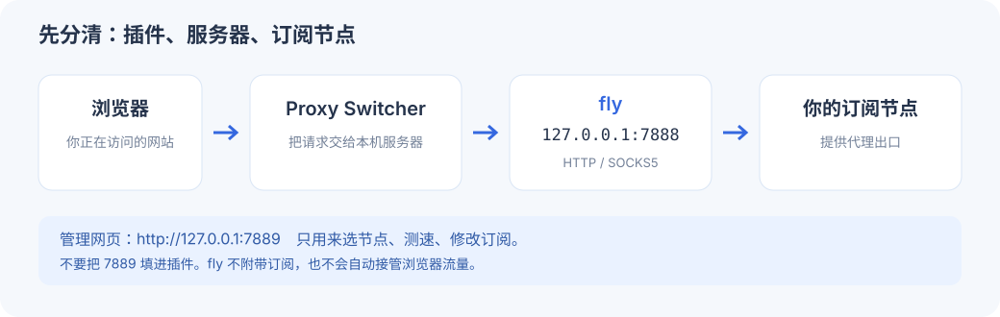

# fly

**搭配 Chrome 插件 Proxy Switcher and Manager 使用的本地代理服务器。**

用命令行启动和停止，用一个蓝白网页搜索和排序节点、测延迟 / 测网站、查看和修改规则、更新或导入订阅。前端使用 **Next.js / React / shadcn/ui**，已经打包进程序，普通用户不需要安装 Node.js，也不需要启动第二个前端服务。

fly 不附带节点或订阅。你提供自己的订阅，插件把浏览器请求交给 fly，fly 再按规则直连或使用你所选的节点。不设置系统代理，不启用 TUN。


## 第一次用，从这里开始

**不熟悉终端、插件或代理也没关系，下面的手册从零开始写。**

| 你现在要做什么 | 看这份图文教程 |
|---|---|
| 安装 fly，不知道 Go / 终端怎么用 | **[安装教程：从打开终端到启动成功](docs/INSTALL.md)** |
| 不知道 Proxy Switcher 是什么、在哪里安装、每个框怎么填 | **[插件超详细教程：安装 → 固定图标 → 填参数 → 保存启用 → 验证 → 切回直连](docs/PROXY_SWITCHER.md)** |
| 已经装好，想换节点、排序、测网站、编辑规则 | **[日常使用图文手册](docs/USAGE.md)** |
| 不知道订阅地址要求、下载不通或想导入文件 | **[订阅格式、下载与缓存说明](docs/SUBSCRIPTIONS.md)** |
| 网页打不开、规则不见了、端口不明白 | **[常见问题：按现象一步步排查](docs/FAQ.md)** |
| 想核对测试结果和验证范围 | [QA 清单与验证记录](docs/QA.md) |
| 想修改 Next.js 页面或参与开发 | [开发说明](docs/DEVELOPMENT.md) |

完整流程是：**安装 fly → 添加自己的订阅 → 安装并配置插件 → 在 fly 里选择节点 → 浏览网页**。



## 熟悉命令行的人可以快速开始（macOS）

先准备 Git、Make、Go 1.26.2 或更高版本。代码仓库需要相应 GitHub 访问权限。

```sh
git clone https://github.com/justis-xu/fly.git
cd fly
make install
fly start
fly ui
```

1. fly 网页点击「添加订阅」，粘贴**自己的完整订阅链接**，点击「保存并更新」。
2. 等到「本机代理已启动」和节点列表出现，选择一个节点或「自动选择」，再点「测网站」确认。
3. 从[官方 Chrome 商店](https://chromewebstore.google.com/detail/proxy-switcher-and-manage/onnfghpihccifgojkpnnncpagjcdbjod)安装 **Proxy Switcher and Manager**。
4. 打开插件 → **Manual Proxy** → Profile Name 填 `fly`；HTTP / SSL Proxy 均填 `127.0.0.1`，对应 Port 均填 `7888`；Server Type 选 **HTTP**；Direct 地址列表填 `localhost, 127.0.0.1`。
5. 点击 Profile Name 右侧**绿色 ✓** 保存并启用。插件的 HTTP 行通常会同步到 SSL / FTP 行，保存前仍请核对。
6. 新开或刷新目标网页。不会安装、找不到按钮时，直接看上面的[逐步截图教程](docs/PROXY_SWITCHER.md)。

## 只有两个本机端口

| 默认地址 | 用途 |
|---|---|
| **`127.0.0.1:7888`** | 给 **Proxy Switcher** 填写的代理地址；支持 HTTP / SOCKS5 |
| **[http://127.0.0.1:7889](http://127.0.0.1:7889)** | fly 唯一管理网页，不能当代理端口 |

没有额外控制端口，旧 `/panel/` 回到同一个网页。首次订阅成功前，只有管理页可用，代理端口尚未就绪。实际端口改过时，以 `fly status` 和页面显示为准。

## 平时只记这几条

| 命令 / 操作 | 用途 |
|---|---|
| `fly start` | 后台启动，重复执行不会再开一套 |
| `fly ui` | 打开管理网页；选节点、测速、更新和修改订阅都在这里 |
| `fly status` | 看服务器和代理是否就绪 |
| `fly update` | 立即更新订阅；也可在网页点击 |
| `fly restart` | 升级程序或改启动参数后重启 |
| 插件 **Direct**，然后 `fly stop` | 切回浏览器直连并停止服务器 |

关闭网页或终端不会停止后台服务器。重启电脑后需要再次 `fly start`。插件可能记住上次代理模式，停止 fly 前请先切 Direct。

订阅中的直连、拒绝和规则集会尽量保留，需要代理的策略使用所选节点。未提供规则的普通节点订阅采用内置分流。可以在「查看 / 修改规则」添加优先执行的域名 / IP 规则。只有交给 fly 的请求才会经过规则；查看 IP 时也可能命中直连。

「本机代理已启动」只说明监听就绪。手动延迟测 Google 204；常用网站需要单独测试，403 / 429 与连接失败分开显示。详细操作和每种故障的恢复步骤都在手册里。

## 数据与许可

配置、缓存和日志位于 `~/.fly/`；可用绝对路径 FLY_HOME 指定独立目录。在线订阅及其规则资源默认每 24 小时更新，文件需重新导入。更换来源先验证，失败保留旧配置；缓存按来源隔离，规则单独保存。`make uninstall` 保留这些数据。

**订阅链接、配置和缓存含凭据，请勿公开分享。** fly 不提供隐藏进程或绕过终端安全检测的功能。

内嵌 [mihomo](https://github.com/MetaCubeX/mihomo) 内核；GeoIP、GeoSite 和 ASN 基础数据随程序提供，订阅规则资源仍按需下载。ASN 数据来自 [MetaCubeX meta-rules-dat](https://github.com/MetaCubeX/meta-rules-dat/releases/tag/latest)。项目采用 AGPL-3.0，见 [LICENSE](LICENSE)。
