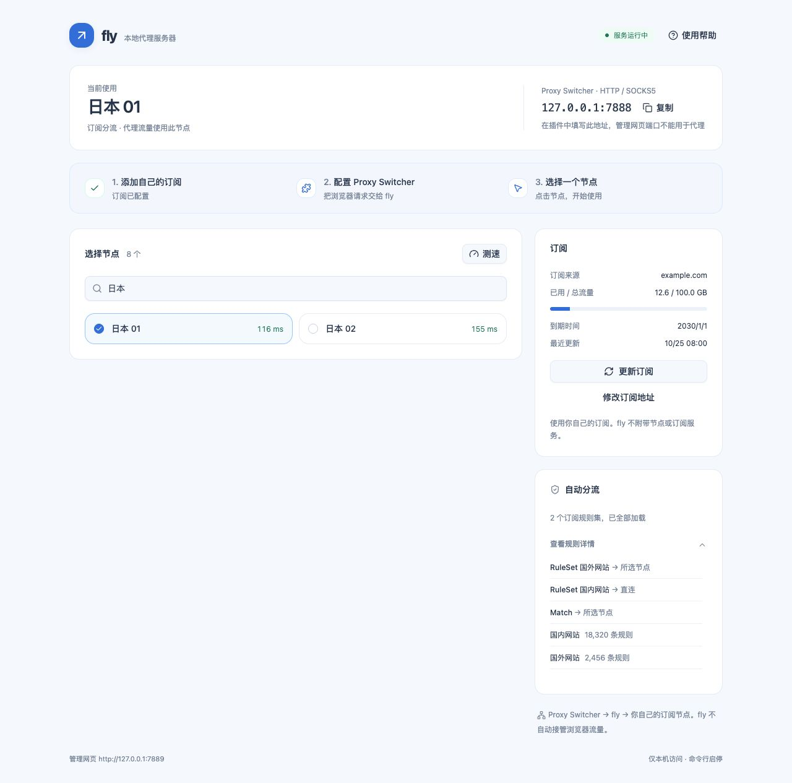

# 常见问题：按你看到的现象排查

如果完全没配置过插件，先看 [Proxy Switcher 从安装到使用的完整教程](PROXY_SWITCHER.md)。这里解决使用中的问题。

## 浏览器突然打不开网页：先恢复，再排查

1. 点 Chrome 的 Proxy Switcher 图标。
2. 点左上角 **Direct**，不是表单最下面那个 Direct 输入框。
3. 关闭面板，刷新网页。此时浏览器不再依赖 fly。
4. 打开终端，执行：

   ```sh
   fly status
   ```

5. 看到「未运行」：执行 `fly start`，等启动完成。
6. 看到「代理尚未就绪」：执行 `fly ui`，检查订阅链接和错误提示。
7. 已运行且有节点：核对插件 **Manual Proxy** 中 HTTP / SSL Proxy 的地址为 `127.0.0.1`、Port 为 `7888`，Server Type 为 HTTP。
8. 确认后点绿色 ✓（内容未变化时可能已保存），再打开目标网站。
9. 仍失败：换另一个节点，查看订阅是否过期、网络是否限制连接。


## Proxy Switcher 到底是什么？它免费送代理吗？

它是浏览器代理配置插件。这里使用的准确名称是 **Proxy Switcher and Manager**，扩展 ID 是 `onnfghpihccifgojkpnnncpagjcdbjod`。插件将浏览器请求发送给你填写的代理服务器，不等于节点服务。fly 也不附带可直接使用的出口；需要你自己的订阅。

商店中有多个相似名字，本文只对应上面的扩展。安装、固定图标和每个输入框的截图见[插件教程](PROXY_SWITCHER.md)。不需要使用插件的 Search 搜索免费代理功能。

## 7888、7889、9000、9090 分别是什么？

| 端口 | 本项目默认用途 |
|---|---|
| **7888** | 本机代理端口，填进插件；HTTP / SOCKS5 共用 |
| **7889** | 唯一管理网页，在浏览器地址栏打开 |
| **9000 / 9090** | 当前 fly 不会启动这些监听 |

这两个默认端口只监听本机。开发者手动启动的 Next 开发服务或演示服务不是普通使用必需项。如果你看到其他端口，先确认是哪一个程序在监听，不要随意结束不认识的进程。

## 为什么管理网页可以打开，但代理还用不了？

管理页会先启动，方便你填写订阅。只有成功加载节点、代理监听就绪，才会显示「服务运行中」。空订阅、失效链接、下载失败或端口冲突，都可能出现“网页可用、代理未就绪”。

先看页面提示，再运行 `fly status`。不要仅凭 7889 能打开就认定 7888 可用。

## 网页显示“无法连接 fly”或者整页打不开

1. 终端执行 `fly start`。
2. 再执行 `fly status`，查看管理网页地址。
3. 在浏览器地址栏打开实际地址，默认 `http://127.0.0.1:7889`。
4. 必须是这台电脑。另一台电脑上的 `127.0.0.1` 指的是另一台自己，不会连接到这里。
5. 若改过管理地址，以实际配置为准；若端口被占用，处理冲突后再启动。
6. 升级后仍看到旧页面，刷新或强制刷新（Chrome：`Command + Shift + R`）。

## 只有 HTTP 能访问，HTTPS 网站打不开

打开插件的 Manual Proxy：

- HTTP Proxy 和 SSL Proxy **两行**都要填 `127.0.0.1`，Port 都是 `7888`。
- 下方 Server Type 选 **HTTP**。
- 点击绿色 ✓ 保存应用。

SSL Proxy 这一行是 HTTPS 网站使用的转发地址，不意味着 Server Type 要选 HTTPS。本机 HTTP 代理通过 CONNECT 处理 HTTPS 网站。

## 看不到节点，或提示订阅无效

1. 确认粘贴的是服务商提供的**完整订阅链接**，不是官网首页、账号登录页或节点名字。
2. 确认链接以 `http://` 或 `https://` 开头；复制时没有漏掉后面的参数。
3. 确认套餐未过期、流量未耗尽、服务商没有重置链接。
4. 看页面错误提示：下载失败先检查网络；无有效节点可能是格式 / 协议不支持。
5. 订阅地址发生变化时，点「修改订阅地址」；只是节点更新时，点「更新订阅」。

不要把真实订阅贴进公开 issue。链接里的令牌往往相当于账号凭据。

## 为什么流量、到期日期没有显示？

这些信息依赖服务商提供。没有响应信息时，fly 只能显示未提供，不能推算余额。能看到节点但没有流量信息，并不必然是订阅错误。

## 更新失败后还能使用？是不是更新好了？

fly 尽量保留之前可用的配置或缓存。还能访问，可能只是旧缓存仍可用。页面出现缓存或更新失败提示，说明本次没有成功获取最新内容。

确认订阅有效、网络可达后，再点「更新订阅」。不要把缓存状态当成最新订阅。

## 规则看不到、规则集数量为零，是不是没生效？

1. 在页面最下方点击「查看规则」，默认折叠是为了保持页面简单。
2. 有分流项但规则集显示「尚未就绪」时，相关资源可能没下载成功、为空或解析失败。
3. 检查订阅更新错误，恢复网络后重新更新。
4. 普通节点链接订阅可能根本不带规则，fly 会采用内置分流。
5. 规则只处理交给 fly 的请求；插件 Direct 模式或其地址绕过列表中的请求，不会到达 fly。



## 选了国外节点，为什么查询到的 IP 没变化？

有三层要分别检查：

1. 插件是否处于 Manual Proxy，指向 fly；不是 Direct 或 System Proxy。
2. fly 是否已就绪，并已选中你想要的节点。
3. 查询网站是否命中 fly 的直连规则，或请求是否在插件绕过列表里。

选节点决定“需要代理时用哪个节点”，不会把所有规则改成全局代理。已有连接也可能继续沿用之前路径，需要刷新或重新连接。

## 测速失败、延迟很低却不能打开某个网站

测速只是对测试网址的一次延迟检查，不是带宽保证，也不是所有网站的可达保证。换节点、刷新目标网页，再检查节点状态和服务商限制。单个网站的问题不要直接推断成整套代理配置都失败。

## 明明点了节点，页面还是旧名字

等请求完成，确认顶部当前连接和节点选中样式一致。失败会保留提示。网络慢或服务失联时，先查看页面提示；恢复后刷新一次。现版本会在切换成功后主动刷新状态，避免等待下一轮后台刷新。

## 找不到插件的保存按钮，或绿色勾号是灰的

0.6.8 的保存按钮是 Profile Name 右侧**绿色 ✓**，不是写着 Save 的大按钮。橙色 × 是删除配置。Profile Name 必须有名字，例如 `fly`。已经保存且内容没有变化时，✓ 变浅是正常的。

## 关闭网页 / 终端后，为什么 fly 还在运行？

`fly start` 启动的是后台服务器。这是为了你不必一直开着终端。需要停止时，先把插件切 Direct，再执行 `fly stop`。重启电脑后需要重新 `fly start`。

## 重启 Chrome 或电脑后，网页打不开

插件可能保留上次 Manual Proxy 模式，而电脑重启会停止 fly。先运行 `fly start`，等服务就绪；或暂时把插件切 Direct。订阅和插件配置不需要每天重填。

## Clash Verge 能不能同时开？

先避免让两套工具同时控制浏览器连接。fly 本身不修改系统代理，但 Chrome 可能被系统代理、其他代理扩展或管理策略影响。本教程使用明确的 Manual Proxy → fly 路径；在切换前确认另一套工具的实际状态。不要仅靠“窗口关掉了”判断它已经停止。

## 提示端口被占用，怎么处理？

先运行 `fly status`，确认是不是 fly 已经在运行。若不是，查清占用端口的程序，再决定停止它或修改 fly 代理端口。不要直接结束未知进程。

需要换代理端口时，按[使用手册的端口修改步骤](USAGE.md#只有端口冲突时才需要修改代理端口)修改 fly、重启，并同步修改插件。改了 fly 没改插件，仍然会失败。

## 安装后提示 `command not found: fly`

先确认 `make install` 是否成功，查看其输出的真实安装目录，再按[安装教程的 PATH 修复步骤](INSTALL.md#提示-command-not-found-fly-怎么办)操作。安装成功不等于终端已经知道命令在哪里。

## 本机订阅文件、日志放在哪里？能直接分享吗？

位于 `~/.fly/`。配置、缓存和日志可能包含完整订阅 URL、令牌或服务商信息。`fly init` 也会打印完整订阅链接。分享故障信息前，删去这些内容，只保留必要的错误现象、版本和操作步骤。

## 公司浏览器限制安装，或者安全软件提示本地服务

按组织允许的方式使用，联系管理员确认。fly 没有隐藏进程、绕过浏览器管理策略或规避安全检测的功能；只监听本机也不代表不会被安全软件识别。

## 卸载会不会删除订阅？

`make uninstall` 只移除所选安装目录里的程序，保留 `~/.fly/`。卸载插件可能删除其保存的配置。完整顺序见[卸载教程](INSTALL.md#10-卸载但保留订阅设置)。

[返回首页](../README.md) · [插件图文教程](PROXY_SWITCHER.md) · [使用手册](USAGE.md)
