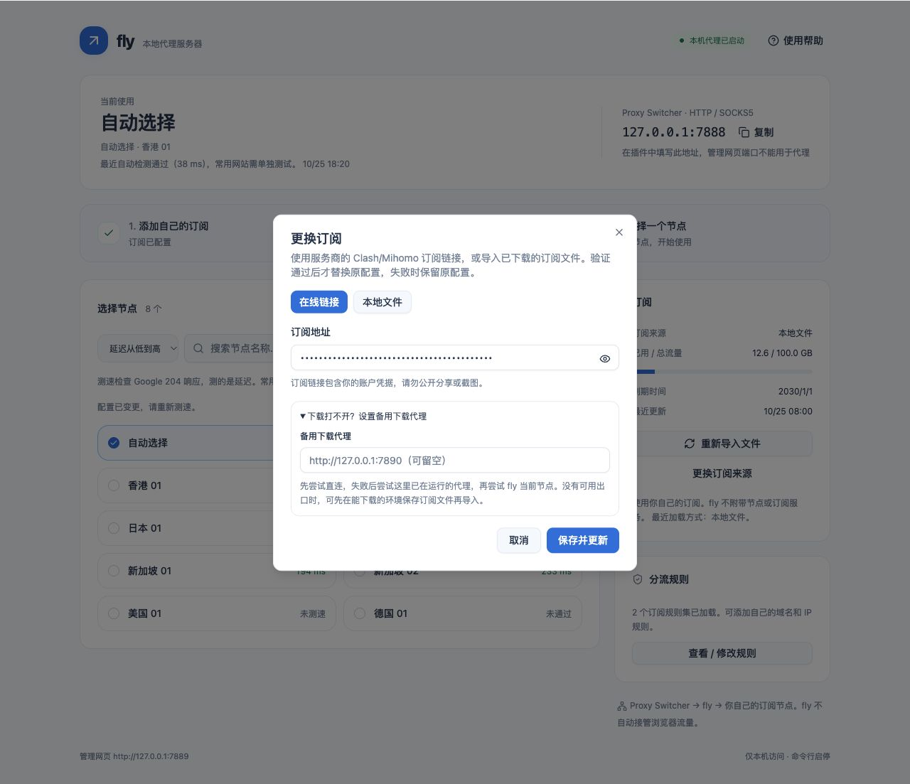

# 常见问题：按你看到的现象排查

还没装插件，请先看 [Proxy Switcher 从安装到使用的完整教程](PROXY_SWITCHER.md)。以下所有「插件」都指 **Proxy Switcher and Manager**，ID 为 `onnfghpihccifgojkpnnncpagjcdbjod`。

## 浏览器突然打不开网页：先恢复，再排查

1. 点 Chrome 右上角插件图标。
2. 点面板左上角 **Direct**。不是表单最下面那个 Direct 地址输入框。
3. 关闭面板，刷新网页，让浏览器先恢复直连路径。
4. 打开终端，运行 `fly status`。
5. 未运行：运行 `fly start`。代理未就绪：运行 `fly ui` 看订阅和端口提示。
6. 本机代理已启动：到 fly 点「测网站」，先测当前节点，再测浏览器分流。
7. 当前节点失败：换一个节点，或点「尝试自动选择」。所有节点都失败时再查套餐和本机网络。
8. 两种测试正常但 Chrome 不通：检查插件 Manual Proxy 的 HTTP / SSL 两行、端口、Server Type，再新开或刷新网页。
9. 仍有问题，按下面相应现象继续排查。不要反复卸载和重装来代替定位原因。

## Proxy Switcher 是什么？免费送代理吗？

它管理浏览器的代理配置，把请求发送给你填写的服务器。它不提供订阅节点；fly 也不附带套餐。需要自己的订阅。

商店有许多相似名字，这份手册只对应上面的 ID。安装、固定图标和每个输入框都在[插件教程](PROXY_SWITCHER.md)里，不需要用 Search 搜索免费代理。

## 7888、7889、9000、9090 分别是什么？

| 默认端口 | 用途 |
|---|---|
| 7888 | 给插件填写的本机 HTTP / SOCKS5 代理 |
| 7889 | 在浏览器地址栏打开的唯一管理页 |
| 9000 / 9090 | fly 不启动这些监听 |

只监听本机回环地址。开发预览的 7899 / 7900、Next 开发端口不属于普通运行。改过端口时，以 `fly status` 和页面显示为准。

## 管理页能打开，为什么代理不能用？

管理页会先启动，方便添加或修复订阅。**「本机代理已启动」只表示本机端口就绪。** 节点可能已经下线，或者某个网站限制访问。

先检查节点和错误提示，再「测网站」。不要把管理页能打开、节点有名字、延迟有数值，当成所有网站都可用。

## 整页打不开，或提示无法连接 fly

1. 运行 `fly start`，再运行 `fly status`。
2. 打开它显示的管理地址，默认 `http://127.0.0.1:7889`。
3. 确认是在这台电脑：另一台电脑的 `127.0.0.1` 指向另一台自己。
4. 改过端口就使用新地址。升级后看到旧页面，在 Chrome 按 `Command + Shift + R` 强制刷新。
5. 端口被其他程序占用时，查清程序再处理，不要随意结束未知进程。

## 订阅链接本地访问不通，怎么首次配置？

1. 先确认完整链接、套餐和格式，详细要求见[订阅说明](SUBSCRIPTIONS.md)。
2. 已有能工作的 HTTP / SOCKS5 下载代理：在订阅弹窗展开「下载打不开？设置备用下载代理」，填完整地址和端口。
3. fly 本身已有可用节点时，也会在直连 / 备用失败后尝试当前实际节点。
4. 第一次还没任何出口时，先在能下载的环境导出文件，再在 fly 选择「本地文件」导入。
5. 文件引用的远端节点来源 / 规则资源仍可能要联网；需要离线使用，请导出已展开节点和内联规则的文件。

只设置 `HTTP_PROXY` 环境变量不会改变 fly 的下载路线。备用地址也必须真有服务在运行，不能随便填一个示例端口。

## HTTP 401 / 403 / 404 / 429 怎么办？

| 下载订阅的状态 | 优先处理 |
|---|---|
| 401 | 检查账号凭据、套餐，必要时让服务商重置链接 |
| 403 | 检查源站限制与服务商要求，再尝试有效的下载出口 |
| 404 | 地址不存在，重新复制完整订阅链接 |
| 429 | 请求太频繁，稍后再试，不要连续点更新 |

这是下载订阅的错误。**测网站时的 403 / 429 是另一回事**：说明已收到目标网站响应，但该网站限制本次请求，不等于整个节点断网。

## 收到网页、没有有效节点或跳过了一些节点

1. 检查是不是复制了登录页、账号主页、PAC 地址。
2. 优先改用服务商的 Clash / Mihomo 导出。
3. 分享链接中未实现的 plugin、传输或伪装参数不能假装连接成功；改用完整 Clash YAML。
4. 节点 UUID、端口、加密参数无效时会跳过；常见占位信息也会过滤。
5. 部分有效时页面会显示跳过数量；全部无效则不替换旧配置。

具体支持表和大小限制见[订阅格式](SUBSCRIPTIONS.md#2-支持什么格式)。链接、配置和缓存不要公开粘贴。

## 更换失败后，为什么仍是旧节点？

这是失败保护。只有新来源验证、启用、缓存和设置保存成功才会替换。失败时旧地址和运行配置保留；不会拿上一份订阅冒充新地址。

看错误原因，修复后再保存。使用缓存也不代表更新成功；缓存里的旧节点仍可能下线。

## 提示旧缓存来源未核实是什么意思？

早期版本缓存没有记来源。首次升级为了保留原来的离线能力，会明确标注这种旧缓存。恢复网络后成功「更新订阅」，才能确认当前地址返回的新内容并清除提示。新地址验证失败不会借用旧来源缓存。

## 代理突然不可用，自动选择也失败

1. 插件切 Direct，先确认基础网络是否能访问平时直连的网站。
2. 看套餐是否到期 / 流量耗尽，服务商是否维护。
3. 测延迟只测 Google 204，失败也可能是该检测地址受限；再测不同网站判断范围。
4. 手动固定节点不会自行换地区；可以点「尝试自动选择」或另一个节点。
5. 如果所有节点和网站都失败，检查本机网络与服务商；缓存不能让已下线的节点恢复。

自动体检每 5 分钟检查一次，页面显示最近记录的日期时间；数分钟前通过不保证此刻仍在线。

## 延迟很低，为什么 ChatGPT / YouTube 还是打不开？

延迟、网站响应和网站完整功能是三件事。

- 「测速」：一个 HEAD 目标，单节点 5 秒，最多 8 并发，整批 90 秒；不是带宽。
- 「当前节点」网站测试：固定实际节点，独立请求六个网站的公开地址。
- 「浏览器分流」测试：经过本机端口，遵循当前规则，可能走直连。
- 网站 2xx 只说明测试地址本次有响应；登录、验证码、地区限制、视频播放仍要在浏览器确认。
- 401 / 403 / 429 标成访问受限，5xx / 其他地址错误也与连接超时分开。

如果当前节点正常、分流异常，查规则；两者正常而 Chrome 异常，查插件。手动与自动延迟采用不同计时窗口，数字不同是正常的。测网站不会清空手动延迟记录。

## 为什么取消后还有些节点没数值？

它们没有完成测试，不能当成 `0 ms` 或坏节点。取消 / 整批超时只保留已完成观察；节点较多时可以之后再测。更换订阅或规则会让旧配置结果失效。

## 怎么排序？排序会切换节点吗？

搜索框左边下拉框可选订阅顺序、名称、延迟、可用优先。自动选择在符合搜索条件时置顶，未测和失败不会排成最快。排序只影响显示；切换节点需要点卡片。

## 规则在哪里？可以自己改吗？

1. 「分流规则」→「查看 / 修改规则」。
2. 「自定义规则」可添加域名或 IP 网段，选代理 / 直连 / 拒绝。
3. 箭头可调整优先级，垃圾桶可删除；最后点「保存规则」。用户规则优先，更新订阅后保留。
4. 「订阅规则」可以搜索顶层分流项。
5. 「规则集内容」选择资源、搜索关键词、翻页，支持常见 MRS 内容。

完整操作见[规则图文步骤](USAGE.md#8-查看和修改规则)。

## 规则集是零条、读不到、更新失败怎么办？

可能是资源为空、格式无效，或者下载失败。看更新提示，检查来源是否可达，恢复网络 / 设置备用下载代理后更新。

第一次必需资源失败会拒绝启用新配置；已有有效资源可保留缓存并明确提示。HTTP 资源随 fly 的订阅更新，默认每 24 小时，不另外沿用来源中更短的规则集周期。

普通节点订阅可能没有规则集，会用内置分流；没有规则集不等于没有分流。文件导入想更新远端内容，需要重新导入。

## 选了国外节点，IP 为什么没变？

分别检查：插件是否 Manual Proxy → fly 是否选中节点 → 查询地址是否命中直连 / 插件绕过。

选节点只决定“需要代理时使用谁”，不会删掉直连规则。插件 Direct、插件绕过地址和浏览器绕过的本机请求不进入 fly。已有连接也可能保持旧路径，刷新或重连后再看。

## 只有 HTTP 可以，HTTPS 不行

插件 Manual Proxy 的 HTTP Proxy、SSL Proxy 两行都填 `127.0.0.1`，Port 都填实际代理端口，默认 `7888`；Server Type 选 **HTTP**，点绿色 ✓。

SSL Proxy 是 HTTPS 网站使用的转发地址，不代表要把类型选成 HTTPS。本机 HTTP 代理通过 CONNECT 转发 HTTPS。

## 找不到保存按钮，或绿色勾号变浅

0.6.8 中保存按钮在 Profile Name 右侧，是**绿色 ✓**，没有写着 Save 的大按钮。Profile Name 要填名字，例如 `fly`。保存后未修改内容时 ✓ 变浅是正常的；橙色 × 用于删除配置。

## 关闭网页、终端，或者重启 Chrome 后怎么办？

关闭网页 / 终端不停止后台服务器。Chrome 重启通常会保留插件配置。电脑重启则需要重新 `fly start`；否则插件可能仍指向一个没启动的服务器。停止前先切 Direct，再 `fly stop`。

`fly run` 是前台调试，用 Ctrl+C 退出；日常按 `fly start` 使用后台方式。

## Clash Verge 能不能同时开？

先确认哪套工具负责当前浏览器路径。fly 不设置系统代理，但 Chrome 仍可能受系统代理、其他扩展或管理策略影响。关闭 Clash 窗口不一定停止其后台服务。本教程使用明确的 Manual Proxy → fly 路径；不需要让两套工具同时接管浏览器。

## 端口被占用，或想换管理地址

先 `fly status` 确认是不是已有 fly。若不是，查清占用程序，不要直接杀未知进程。

换端口必须先在插件切 Direct、`fly stop`，再 `fly init --port ... --admin ...`，然后启动，同步修改插件代理端口和浏览器管理地址。完整示例见[端口修改步骤](USAGE.md#只有端口冲突时才需要修改代理端口)。两个端口不能相同，管理地址必须是本机回环 IP。

## 安装提示 command not found，或 Go 依赖下载失败

先按[安装教程](INSTALL.md)核对 Git / Make / Go 和 PATH；`make install` 成功不等于终端已能找到命令。

首次编译需要访问 GitHub 和 Go 依赖源。报下载超时先恢复安装环境网络，再重试；浏览器插件能上网不代表终端编译自动走插件。不要通过关闭依赖校验来跳过下载错误。

## 换电脑要复制旧目录吗？Windows 可以用吗？

新 Mac 可以从零安装、添加自己的订阅，不需要复制旧电脑目录。需要保留自定义规则时可备份自己的私有设置，但不应把缓存当作其他人的节点来源。

完整桌面安装和插件实测面向 macOS + Chrome。项目守护进程使用 Unix 接口，**当前不提供 Windows 安装支持**；不要把 macOS 命令直接复制到 Windows。Linux 开发环境可能需要手动打开网页，不能把本次 Mac 插件截图当成 Linux 实测。

## 数据和日志在哪？卸载会删除吗？

默认 `~/.fly/`；高级环境指定绝对路径 `FLY_HOME` 时使用该目录。`fly.yaml`、按来源缓存、规则和日志可能含凭据，不要整体分享。

`fly init` 只显示是否设置来源；真实链接仍保存在自己的配置文件。`make uninstall` 仅移除所选程序，保留数据。若安装用过自定义 DEST，卸载也要使用同一目录。[完整卸载步骤](INSTALL.md#10-卸载但保留订阅设置)。

## 公司浏览器限制或安全软件提示本地服务

按组织允许的方式使用，联系管理员确认。fly 没有隐藏进程、绕过浏览器管理策略或规避安全检测的功能；仅本机监听也不代表不会被识别。

[返回首页](../README.md) · [插件超详细教程](PROXY_SWITCHER.md) · [使用手册](USAGE.md) · [订阅要求](SUBSCRIPTIONS.md)
