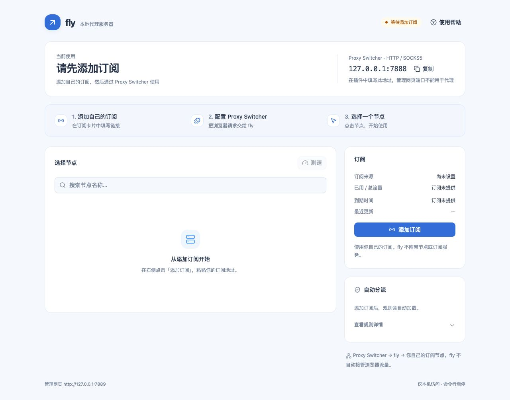
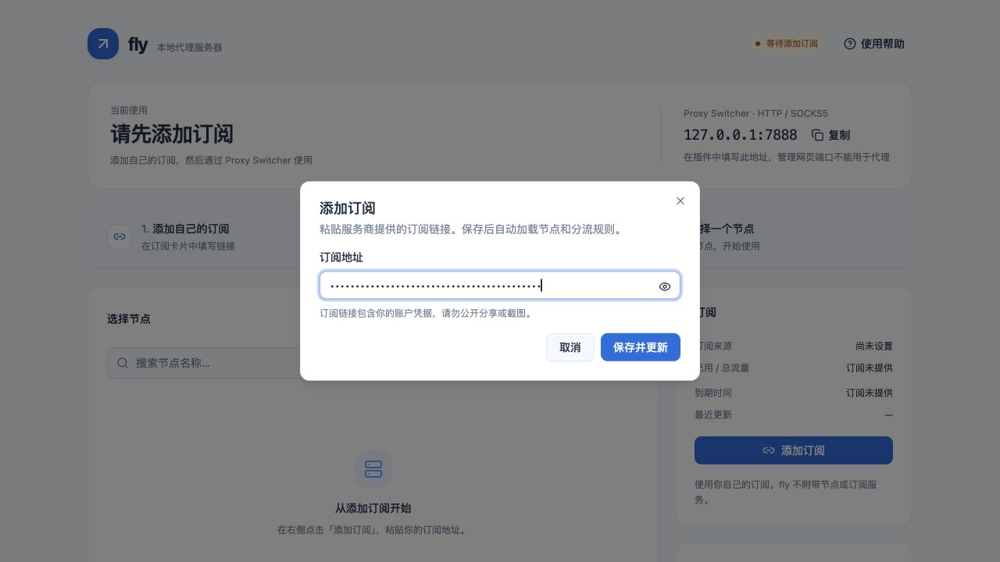

# 安装 fly：从打开终端开始（macOS）

这份教程适用于 **Mac**，默认使用桌面版 Chrome 和 [Proxy Switcher and Manager](PROXY_SWITCHER.md)。fly 是本机服务器，你还需要自己的订阅。首次安装需要下载依赖，保持联网。

**普通使用只需要安装 Git、Make、Go。无需安装 Node.js、npm 或启动 Next.js。** 前端已经打包在 fly 里。

## 1. 打开终端，认识怎么输入命令

1. 按 `Command + 空格` 打开 Spotlight 搜索。
2. 输入「终端」或 `Terminal`。
3. 按回车，打开系统自带终端。
4. 复制本文代码框内的命令，粘贴到终端，再按回车。
5. 等待执行完，出现下一行可输入的位置，再继续下一步。

不要把代码框外的解释文字粘进去。代码里没有需要复制的 `$` 或 `%` 前缀。报错时先处理当前步骤，不要一路往下执行。

## 2. 安装 Git 和 Make 所需的 Apple 命令行工具

在终端执行：

```sh
xcode-select --install
```

- 如果出现安装窗口，按窗口提示完成安装，可能需要等几分钟。
- 如果提示工具已经安装，直接继续。
- 不需要为了 fly 下载完整的 Xcode。

安装完后，分别执行：

```sh
git --version
make --version
```

两条命令都应输出版本信息。若提示命令找不到，完成 Apple 安装后关闭终端，重新打开，再试一次。

## 3. 安装 Go

1. 点左上角苹果菜单 →「关于本机」。
2. 看「芯片 / 处理器」：Apple M 系列选 **Apple Silicon / ARM64**，Intel 处理器选 **Intel / AMD64**。
3. 打开 [Go 官方下载页](https://go.dev/dl/)。
4. 下载与你的芯片对应的 **macOS 安装包 `.pkg`**，版本需要 **Go 1.26.2 或更高**。
5. 打开下载的安装包，按安装器提示完成安装。
6. 关闭旧终端窗口，重新打开终端。
7. 执行：

   ```sh
   go version
   ```

8. 应出现类似 `go version go1.26.2 darwin/arm64` 的文字。你的版本可以更新；Intel Mac 的结尾可能是 `darwin/amd64`。

如果仍是 `command not found: go`，先重新打开终端；再检查官方安装器是否成功，不要反复安装 fly 来解决 Go 未安装的问题。

## 4. 下载 fly 的代码

建议把代码放在固定位置，之后升级还要用到它。下面会建立 `~/Projects` 文件夹：`~` 表示你的个人主目录。

依次执行，每行按一次回车：

```sh
mkdir -p ~/Projects
cd ~/Projects
git clone https://github.com/justis-xu/fly.git
cd fly
```

成功后，终端当前位置就是项目目录。可以执行：

```sh
pwd
```

结尾应是 `/Projects/fly`。

出现不同情况时：

| 提示 | 怎么处理 |
|---|---|
| `Repository not found` / 要求登录 | 确认 GitHub 账号拥有仓库访问权限；私有仓库需要先配置 GitHub 认证 |
| `Authentication failed` | GitHub HTTPS 不接受账号密码作为 Git 密码；使用你已有的 GitHub CLI、SSH 或访问令牌认证方式，不要把令牌贴到 issue |
| `destination path 'fly' already exists` | 已有同名文件夹，不要删除它；如果就是本项目，执行 `cd ~/Projects/fly` 进入已有代码 |
| 连接超时 | 检查网络是否能访问 GitHub，恢复后再重试 |

已经使用 SSH 认证的人，也可以将克隆地址换成 `git@github.com:justis-xu/fly.git`；两种方式选一种即可。

## 5. 安装 fly 命令

确保终端在项目目录，执行：

```sh
make install
```

首次执行会下载 Go 依赖并编译，等待命令结束。成功时会显示：

```text
已安装到 /某个目录/fly
```

安装位置由环境决定：优先使用可写的 `/opt/homebrew/bin`，否则是 Go 的 `GOPATH/bin`。**以你屏幕上的实际输出为准。**

再执行：

```sh
command -v fly
fly version
```

第一条应显示安装路径；第二条应显示 `fly 0.1.0`（版本以项目为准）。这说明终端已经能找到 fly。

### 提示 `command not found: fly` 怎么办

如果 `make install` 已经成功，但找不到命令：

1. 查看安装时最后一行的路径。
2. 如果安装到了 Go 的目录，执行以下两行，把这个目录加入当前终端的搜索路径并保存到 `~/.zprofile`：

   ```sh
   export PATH="$(go env GOPATH)/bin:$PATH"
   printf '\nexport PATH="%s/bin:$PATH"\n' "$(go env GOPATH)" >> ~/.zprofile
   ```

3. 再运行 `fly version`。下次打开新终端也会读取保存的路径。
4. 这两行只需处理路径时执行一次，不需要每次启动都追加。

如果你自行指定了安装目录，例如 `make install DEST="$HOME/.local/bin"`，请把**那个目录**加入 PATH，而不是照抄另一个目录。PATH 的作用只是让终端找到已安装的命令，不会启动代理。

## 6. 启动服务器并添加订阅

现在可以在任意目录执行：

```sh
fly start
fly ui
```

- `fly start`：启动后台服务器。看到「已在后台启动」或「已在运行」即可。
- `fly ui`：打开管理网页。它不代替启动命令。
- 没自动打开时，在浏览器地址栏输入 **http://127.0.0.1:7889** 并回车。

首次使用应看到：



1. 点击右侧「添加订阅」。
2. 去自己的订阅服务商页面复制**完整的订阅链接**，不是账号主页地址，也不是节点名称。
3. 粘贴到「订阅地址」输入框。默认显示圆点是正常的，需要核对时点击眼睛图标。
4. 点击「保存并更新」。
5. 等待加载。首次可能下载规则资源，慢网络下需要一两分钟。
6. 看到节点列表和「服务运行中」，说明代理服务器已准备好。
7. 点击一个节点，或选择「自动选择」。



如果提示失败，保持网页打开，检查链接是否完整、订阅是否有效、网络能否访问订阅源，再修改或重试。项目没有自带订阅。没有成功加载订阅前，管理网页可以打开，但代理端口尚未就绪。

## 7. 安装和配置浏览器插件

**现在打开 [Proxy Switcher 完整图文教程](PROXY_SWITCHER.md)。** 它从“插件是什么”开始，逐步说明在哪里安装、如何固定图标、每个输入框填什么、怎样启用、怎样切回直连。

先记住不要填反：

| 位置 | 应使用的默认地址 |
|---|---|
| Chrome 地址栏里打开管理页 | `http://127.0.0.1:7889` |
| Proxy Switcher 的 HTTP Proxy / SSL Proxy | 主机 `127.0.0.1`，Port `7888`，Server Type 选 HTTP |

## 8. 每天使用和关闭

电脑没重启、fly 已经在运行时，不需要反复启动。平时用 `fly ui` 打开网页，选节点或更新订阅。

重启电脑后：

```sh
fly start
fly ui
```

再在插件中选择 **Manual Proxy**，确认是已保存的 `fly` 配置。

不用时先把插件切到 **Direct**，再执行：

```sh
fly stop
```

关闭终端或关闭 fly 网页**不会**停止后台服务器；重启电脑会停止。项目默认不创建开机自启任务。

## 9. 升级到仓库最新版

先在插件中切到 **Direct**。以下操作会替换本机 fly 程序，但保留配置与缓存。

1. 打开终端，回到安装时保存的代码目录：

   ```sh
   cd ~/Projects/fly
   ```

2. 查看代码目录有没有你自己修改的文件：

   ```sh
   git status --short
   ```

3. **没有输出**时，依次执行：

   ```sh
   git pull --ff-only
   make install
   fly restart
   fly status
   ```

4. 如果状态列出了文件，先保存自己的改动，不要用强制覆盖或删除来“解决”。
5. 打开 fly 管理页并刷新，确认服务运行、节点仍在。
6. 在插件切回 Manual Proxy，刷新目标网页。

升级普通程序不需要运行 `npm install`。只有开发前端的人才需要[开发说明](DEVELOPMENT.md)。

## 10. 卸载，但保留订阅设置

1. 在插件中选择 **Direct**，让浏览器不再依赖 fly。
2. 在终端执行：

   ```sh
   fly stop
   cd ~/Projects/fly
   make uninstall
   ```

3. 如果已经停止，`fly stop` 可能提示未运行；可以继续卸载。
4. `make uninstall` 删除的是当前 Makefile 选定目录中的 fly 程序，**保留 `~/.fly/` 配置和缓存**。如果安装时指定过 DEST，卸载也要使用相同 DEST。
5. 运行 `command -v fly` 检查是否还有另一个安装副本。你自行移动过程序时，需要按实际位置处理。
6. 插件可保留在 Direct；如也想移除插件，去 `chrome://extensions/`，找到准确名称后点击「移除」。插件保存的配置可能随移除丢失。

`~/.fly/` 中含订阅地址和凭据，不要上传到 GitHub，也不要把整个目录作为故障附件公开分享。本文不要求删除它。

[返回首页](../README.md) · [插件图文教程](PROXY_SWITCHER.md) · [常见问题](FAQ.md)
