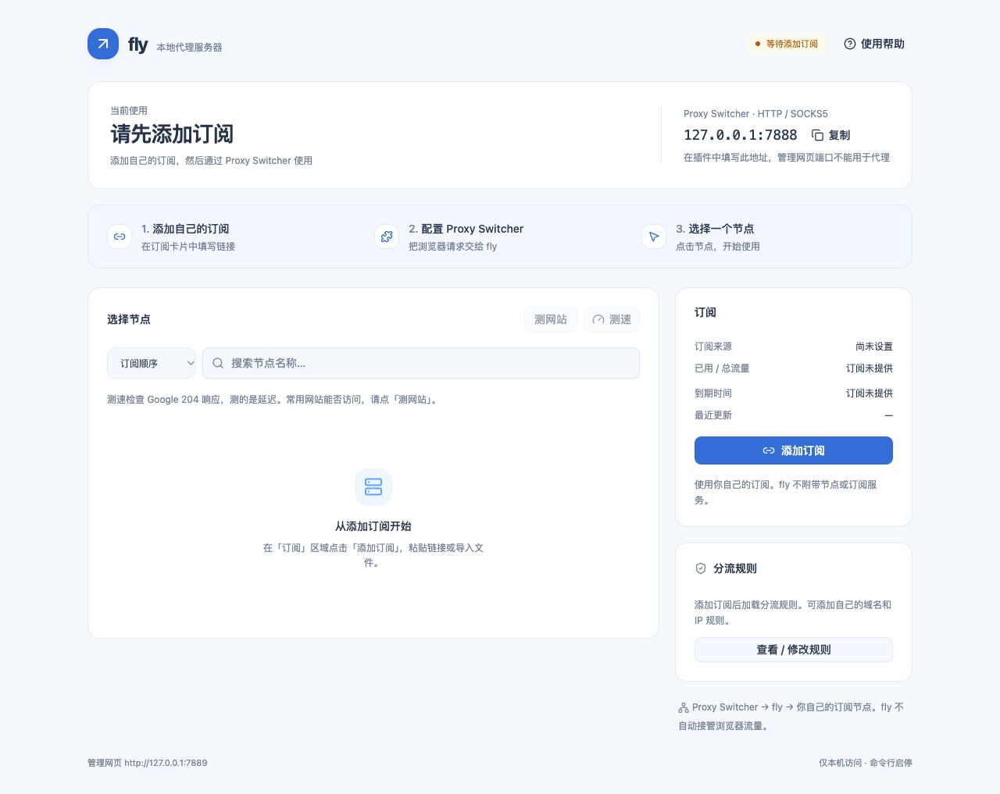
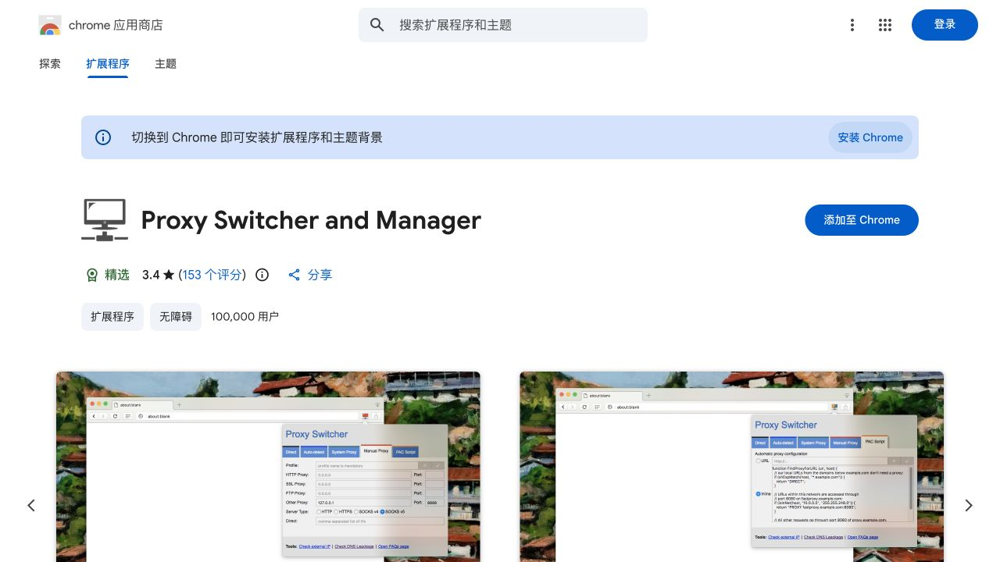
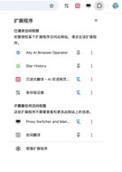
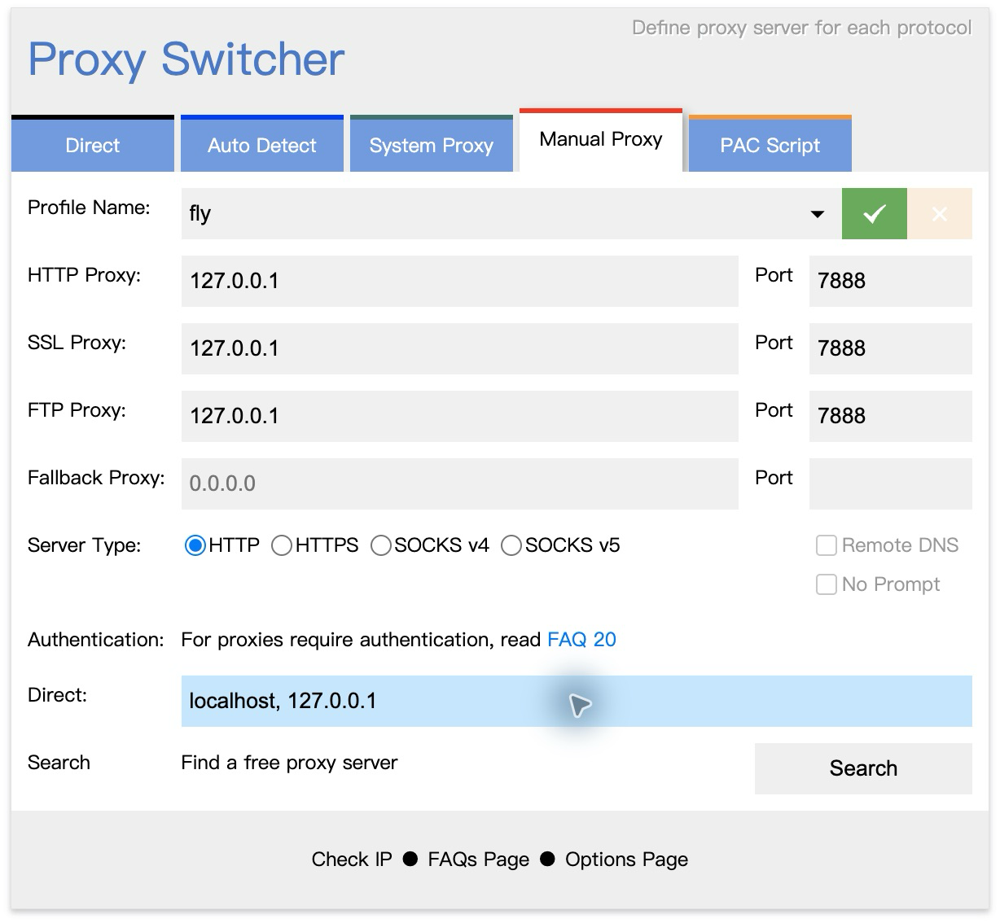
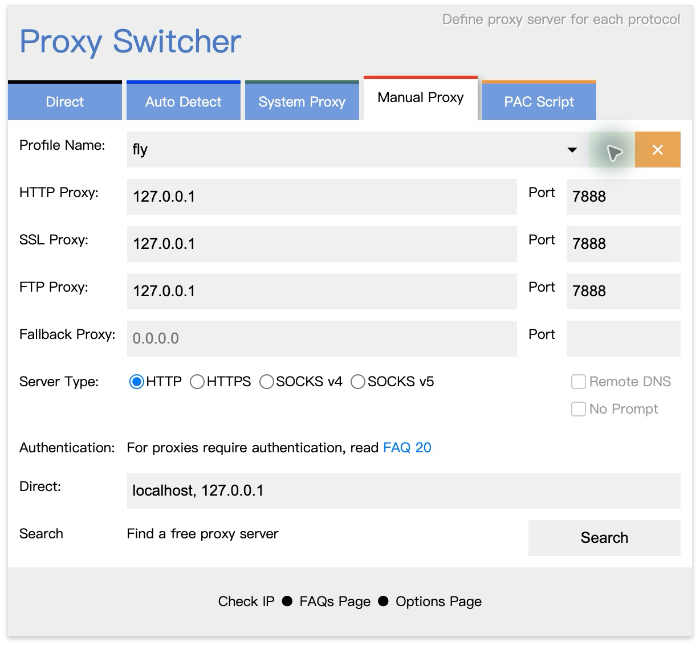
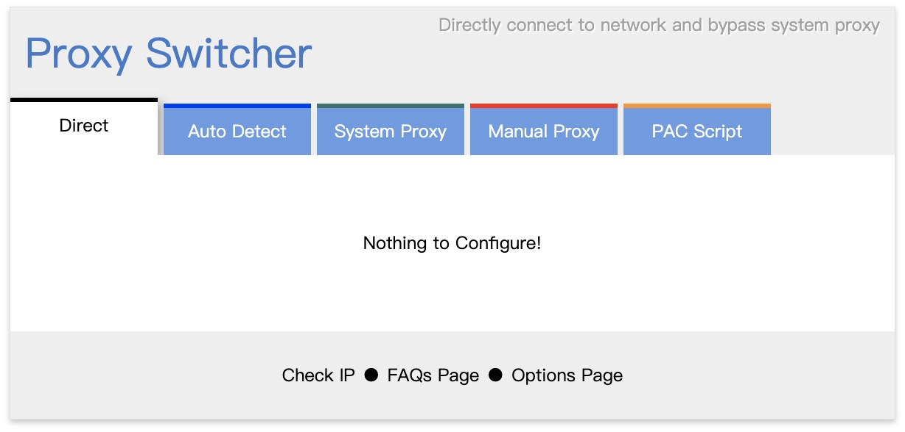
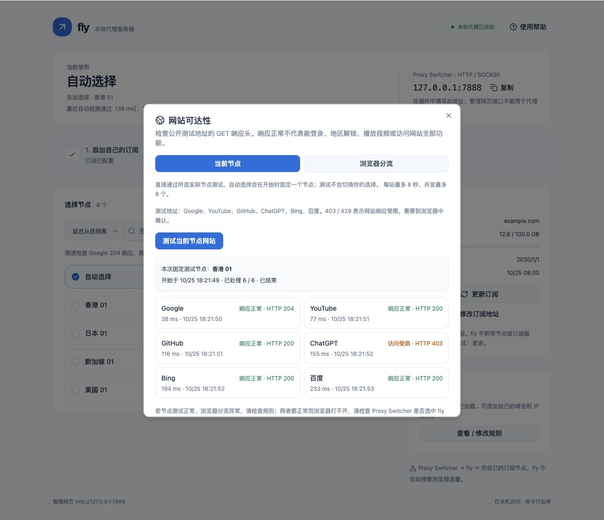

# Proxy Switcher 从安装到使用：一步一步照着做

这份教程写给第一次使用浏览器代理插件的人。以 **macOS 上的桌面版 Google Chrome**、**Proxy Switcher and Manager 0.6.8** 和 fly 默认配置为例。按钮截图来自实际安装的这个插件；不同浏览器、语言或后续版本的外观可能变化。

**已经装好 fly、已经能看到节点的人，从[第三步](#第三步把插件图标固定到地址栏旁边)开始即可。** 尚未安装 fly 的人，请先看[安装教程](INSTALL.md)。

## 先弄懂：这三个东西分别干什么

| 名称 | 用白话解释 | 你要做的事 |
|---|---|---|
| Proxy Switcher | 装在 Chrome 里的小插件，告诉浏览器“把请求发到哪里” | 安装一次，填入 fly 的地址，需要时开关 |
| fly | 在你的电脑后台运行的本地代理服务器 | 用命令启动，在一个网页里选节点、更新订阅 |
| 你自己的订阅 | 订阅服务商提供的一条链接，里面包含节点，可能还包含分流规则 | 从自己的服务商处复制，填到 fly 网页 |

**插件本身不是节点服务，也不会自动送你可用的代理。fly 也不附带节点、账号或免费订阅。** 三者要配合使用。


两个数字记住即可：

- **7888：给插件填写的代理端口。** 主机填 `127.0.0.1`，意思是“这台电脑自己”。
- **7889：给你打开 fly 管理网页的端口。** 在地址栏打开 `http://127.0.0.1:7889`。

不要把网页地址填进插件的主机框，不要把订阅链接填进插件，不要把 7889 填成代理端口。本教程所有端口都是默认值；如果你自行修改过，以 fly 页面上的「代理地址」为准。

## 第一步：准备好浏览器和 fly

1. 打开电脑上的 **Google Chrome**。本教程的插件不是手机 App，也不是 Safari 插件。
2. 使用普通窗口。先不要使用无痕窗口或访客窗口。
3. 打开「终端」，输入下面这行，按回车：

   ```sh
   fly start
   ```

4. 再输入下面这行，按回车：

   ```sh
   fly ui
   ```

5. 浏览器应打开 fly。没有自动打开时，在 Chrome 地址栏粘贴 `http://127.0.0.1:7889`，按回车。
6. 如果页面提示添加订阅，点击「添加订阅」，粘贴你自己的完整订阅链接，再点「保存并更新」。订阅链接必须来自你自己的服务商；不要复制本文截图里的示例链接。
7. 等待节点列表出现，并确认顶部显示「本机代理已启动」。首次下载可能需要一两分钟。若失败，先按页面提示修正订阅，不要反复点击更新。
8. 点击一个节点，或点击「自动选择」。这一步之后再配置插件。




成功时的页面类似下图。这里的节点名、日期和流量都是演示数据，你自己的数值会不同。


## 第二步：安装正确的 Proxy Switcher

### 2.1 打开指定的官方商店页面

在 **Chrome** 中点击这个链接：

**[打开 Proxy Switcher and Manager 的 Chrome 应用商店页面](https://chromewebstore.google.com/detail/proxy-switcher-and-manage/onnfghpihccifgojkpnnncpagjcdbjod)**

如果链接没有在 Chrome 中打开：

1. 复制上面链接的地址。
2. 切换到 Chrome。
3. 按 `Command + L`，光标会进入顶部地址栏。
4. 按 `Command + V` 粘贴，按回车。
5. 等待商店页面加载。

认准下面的信息，避免装到其他同名插件：

| 要核对的内容 | 本教程对应的插件 |
|---|---|
| 商店名称 | **Proxy Switcher and Manager** |
| 地址中的扩展 ID | `onnfghpihccifgojkpnnncpagjcdbjod` |
| 本次核对时的提供方 | `yokris.dev` |
| 本次截图对应版本 | `0.6.8` |
| 打开后面板上的大标题 | **Proxy Switcher** |



图中是官方商店网页，拍摄环境为内置浏览器，所以页面还提示“切换到 Chrome”；**实际安装请在 Google Chrome 普通窗口操作**。不需要开启开发者模式。下文的插件面板截图则来自真正安装了插件的 Chrome。

### 2.2 点击安装并确认

1. 在商店页面右侧找到 **「添加至 Chrome」/ Add to Chrome**，单击一次。
2. Chrome 会弹出安装确认框，名称应仍是 **Proxy Switcher and Manager**。
3. 阅读弹窗列出的权限。这个插件的用途是管理浏览器代理设置，安装后由它控制 Chrome 的代理连接。
4. 确认你要安装这个插件后，点击 **「添加扩展程序」/ Add extension**。
5. 等待下载和安装完成，不要反复点击。
6. 看到“已添加”提示，或商店按钮变成 **「从 Chrome 中移除」**，说明已装好。**不要点击「移除」**。
7. 安装后可能打开开发者的介绍页；可以关掉介绍页，继续下面的操作。

安装确认框没有在本次截图中重拍：测试机已安装该插件，未为了补图卸载现有插件。上面保留了完整的文字操作；安装与权限提示以你自己的 Chrome 为准。

### 2.3 如果没有安装成功

| 你看到的情况 | 接下来怎么做 |
|---|---|
| 商店已经显示「从 Chrome 中移除」 | 已经安装，直接进入第三步 |
| 按钮灰色 | 确认是桌面 Chrome 普通窗口，不是本教程预览、无痕或访客窗口；再重新打开官方链接 |
| 提示“管理员阻止”或“由贵组织管理” | 联系设备或浏览器管理员确认是否允许安装和使用 |
| 商店打不开、下载一直失败 | 先检查当前网络是否能访问商店；使用已有的获准网络连接安装。fly 不包含离线插件安装包 |
| 名字或界面和本文完全不同 | 比较扩展 ID；不要照着本文给另一个同名插件填参数 |

## 第三步：把插件图标固定到地址栏旁边

“安装完成”和“工具栏看得到”是两回事。插件可能已经装好，只是图标藏在扩展菜单里。

1. 看 Chrome 最上面的地址栏。
2. 在地址栏**右边**找到一个像拼图块的 **「扩展程序」**图标，点击它。
3. 在弹出的列表中找到 **Proxy Switcher and Manager**。
4. 点击这一行**右侧的图钉**，不是最右边的三个点。
5. 图钉变为固定状态后，地址栏旁边会多出插件图标。
6. 如果鼠标移上去显示「取消固定 Proxy Switcher and Manager」，就说明已经固定，**不用再点一次**。
7. 点击菜单外的空白处，关闭这个列表。



上图为菜单局部放大截图：在靠下的「不需要任何访问权限」区域找到 Proxy Switcher and Manager，名字右边第一个小图标就是图钉；本图中已经固定。其他插件只是测试浏览器已有的扩展，**不需要跟着安装**。图片较小时可点击图片查看原图；按名字找对应行即可。

找不到拼图图标时，可以在地址栏输入 `chrome://extensions/` 并回车。找到该插件，确认右下角开关已开启。正常商店安装不要求开启「开发者模式」。

## 第四步：打开插件，填写 fly 的地址

### 4.1 打开面板

1. 点击刚才固定的插件图标。鼠标停在图标上时，提示文字包含 **Proxy Switcher**。
2. 会弹出标题为 **Proxy Switcher** 的面板。
3. 面板上方有一排选项：`Direct`、`Auto Detect`、`System Proxy`、`Manual Proxy`、`PAC Script`。
4. 点击 **Manual Proxy**，中文意思是“手动配置代理”。

**这个插件点击选项卡就会切换浏览器代理模式。** 第一次点击 Manual Proxy 时，可能临时使用它的旧参数或默认端口 8888；先照下面填完并保存，再去打开其他网站。

### 4.2 按顺序填写，不用自己猜

照下表一行一行填写。输入之前，可以先点击输入框，按 `Command + A` 全选，再输入新内容。

| 面板上的英文 | 你要怎么填 | 说明 |
|---|---|---|
| **Profile Name** | `fly` | 给这份配置取个名字；原本随机出现的英文动物名可以覆盖 |
| **HTTP Proxy** | `127.0.0.1` | 只填数字地址，不加 `http://`，不加 `:7888`，不加斜杠 |
| HTTP Proxy 这一行右侧 **Port** | `7888` | 只填数字，不是 7889，也不是默认的 8888 |
| **SSL Proxy** | `127.0.0.1` | HTTPS 网站也发给 fly；填 HTTP 行时通常会自动同步到这一行，仍请核对 |
| SSL Proxy 右侧 **Port** | `7888` | 与上一行相同 |
| **FTP Proxy** | `127.0.0.1` | HTTP 行通常会自动同步；保持同步即可，不需要另外找服务器 |
| FTP Proxy 右侧 **Port** | `7888` | 与上一行相同 |
| **Fallback Proxy** 与右侧 Port | **留空** | 灰色的 `0.0.0.0` 是占位提示，不是要求你填写它 |
| **Server Type** | 点选 **HTTP** 前的圆圈 | 点中后圆圈有蓝点；不要选 HTTPS |
| **Remote DNS** | 保持未勾选 | Chrome 的此项可能是灰色；本教程用 HTTP，无须修改 |
| **No Prompt** | 保持未勾选 | 不需要代理账号认证 |
| **Direct** 输入框 | `localhost, 127.0.0.1` | 英文逗号分隔，让本机网页直接访问；不要把目标网站随意放进这里 |

**特别注意两个容易混淆的地方：**

- 「SSL Proxy」这一行是在指定 HTTPS **网站**的转发地址；下方「Server Type」是在指定浏览器如何连接**本机代理服务器**。本教程的 Server Type 仍然选 **HTTP**，fly 会处理 HTTPS 网站的 CONNECT 请求。
- 面板下半部的「Direct」**输入框**是“不走代理的地址列表”；最上排的「Direct」**选项卡**是“整个浏览器切回直连”。它们用途不同。



本教程统一使用 HTTP 这一种方式。fly 同一端口也支持 SOCKS5，但初次配置不需要再额外创建一份 SOCKS 配置。

### 4.3 保存并启用：点绿色“✓”

1. 再检查一遍：名字 `fly`，HTTP / SSL 的地址 `127.0.0.1`，端口 `7888`，Server Type 选 **HTTP**。
2. 找到 **Profile Name 那一行最右侧附近的绿色“✓”按钮**。
3. 点击绿色 **✓** 一次。它会**保存这份配置并应用到浏览器**，不需要再找另一个“启用”开关。
4. 旁边的橙色 **×** 是删除配置，不要点击。
5. 保存后，绿色 ✓ 可能变浅、不能再点，表示当前内容没有改动，**不是保存失败**。
6. 点击面板外的空白区域关闭它。
7. 再点击插件图标打开面板，确认仍然停在 **Manual Proxy**，Profile Name 是 `fly`，地址和端口没有变。

有些版本的悬停提示与图标含义不一致；本文按 **0.6.8 实际按钮行为**核对，以绿色 ✓ 保存、橙色 × 删除为准。



## 第五步：确认真的能用

按顺序检查，不要只看一个“绿色”就认为全部成功。

1. 回到 fly 页面，确认顶部是「本机代理已启动」，节点列表不是空的。
2. 点击一个节点。顶部「当前使用」应显示刚才选的名字。也可以先用「自动选择」。
3. 打开插件，确认 **Manual Proxy** 选中，配置名是 `fly`，HTTP 和 SSL 的端口都是 `7888`。
4. 在 Chrome 新开一个标签页，打开你需要访问、且当前网络允许测试的网站。已经打开的网页需要刷新。
5. 如果网站正常加载，说明这一条浏览器访问路径已经可以使用。更换节点后刷新网页，再观察是否改善。
6. 想进一步看出口信息，可以点插件底部 **Check IP**。它会打开第三方 IP 查询页。该网站会看到这次请求的出口 IP。
7. **IP 没变不一定是插件失败**：fly 有分流规则，测试网站可能命中直连；选择了不同节点也不代表这个网站一定走节点。结合[规则说明](USAGE.md#8-查看和修改规则)判断。

测速数值只代表测试网址的延迟；不能保证所有网站都能打开。网页打不开时，优先照[故障排查](FAQ.md)检查服务、端口、节点和订阅。

## 第六步：不用时切回直连，再停止 fly

只想让浏览器暂时不通过 fly：

1. 点插件图标。
2. 点最上排左侧的 **Direct**。
3. 面板会出现 **Nothing to Configure!**，上方说明直接连接网络。此时不需要再保存。
4. 关闭面板，刷新原来打不开的网页。



想同时停止后台服务器：

1. 先完成上面切回 Direct 的动作。
2. 打开终端，输入并回车：

   ```sh
   fly stop
   ```

3. 看到「fly 已停止」即可关闭终端。

不要倒过来：如果 fly 已停止，插件还处于 Manual Proxy，Chrome 可能显示 `ERR_PROXY_CONNECTION_FAILED`。这时先点 **Direct** 就能恢复不通过 fly 的连接。

## 明天、重启电脑后，怎么继续用

**已经配置过一次，不需要每天重新安装插件、重新填订阅。**

1. 打开终端，运行 `fly start`。
2. 运行 `fly ui`；等顶部显示「本机代理已启动」。
3. 点插件图标，点 **Manual Proxy**。
4. 查看 Profile Name 是否是 `fly`。如果不是，点名字右侧的小下拉箭头，在列表中选择 `fly`。
5. 若这时绿色 ✓ 可点击，点一次以应用选中的配置。重新打开面板核对配置。
6. 打开或刷新目标网页。

插件可能记住上次模式。因此重启 Chrome 后先检查，不要假定它自动变成 Direct。重启电脑后，fly 需要重新运行 `fly start`，项目默认不配置开机自启。

## 常见操作：到底去哪个地方点

| 你想做什么 | 去哪里做 |
|---|---|
| 浏览器使用 / 暂停使用 fly | 插件的 Manual Proxy / Direct |
| 切换香港、日本等节点 | fly 网页的节点列表，不是在插件里填写节点地址 |
| 更新订阅内容 | fly 网页的「更新订阅」 |
| 更换订阅链接 | fly 网页的「修改订阅地址」 |
| 看规则是否加载 | fly 网页「分流规则」→「查看 / 修改规则」 |
| 改代理端口 | 先改 fly 配置并重启，再修改插件 HTTP / SSL 的 Port；初学者通常不需要改 |

不需要使用 Auto Detect、System Proxy、PAC Script，也不需要点 **Search / Find a free proxy server**。Search 会搜索其他代理，与自己的订阅无关，还可能替换你刚填好的参数。

本教程验证的是 Chrome。Edge 可以参考 [Microsoft 官方扩展安装说明](https://support.microsoft.com/en-us/edge/add-turn-off-or-remove-extensions-in-microsoft-edge)安装 Chrome 商店扩展，但按钮和菜单位置可能不同，本文不把 Chrome 截图当作 Edge 实测。Safari、手机浏览器和无痕模式不在此入门流程内。

## 安装或填写时卡住了

- **找不到插件图标**：回第三步，先固定，再确认 `chrome://extensions/` 中插件开关已开启。
- **找不到“Save”或“Apply”文字**：本版是绿色 **✓** 图标，位于 Profile Name 右侧。
- **绿色 ✓ 点不了**：先检查 Profile Name 是否为空；若内容已保存且未修改，变浅是正常的。
- **只开得了 HTTP 网站，HTTPS 网站失败**：检查 SSL Proxy 行，必须同样是 `127.0.0.1`、`7888`；Server Type 仍选 HTTP。
- **插件已开但所有网页打不开**：先切 Direct 恢复浏览，然后运行 `fly status`；按[排查顺序](FAQ.md#浏览器突然打不开网页先恢复再排查)处理。
- **管理网页能开，代理不能用**：7889 网页可用不代表 7888 已就绪。fly 必须已成功加载订阅节点。
- **Chrome 显示由其他扩展控制代理**：检查是否有另一个代理 / VPN 扩展正在控制 Chrome，一次只让一套已获准的代理配置生效。
- **浏览器或安全软件阻止操作**：按本机管理策略处理，联系管理员。这个项目没有隐藏进程或绕过安全检测的功能。

## 资料与截图说明

- [官方 Chrome 商店](https://chromewebstore.google.com/detail/proxy-switcher-and-manage/onnfghpihccifgojkpnnncpagjcdbjod)：用于核对唯一扩展 ID、名称和发布版本。
- [Chrome 官方安装与管理帮助](https://support.google.com/chrome/answer/2664769?hl=zh-Hans)：用于核对安装入口和安装确认流程。
- [插件官方源码](https://github.com/rNeomy/proxy-switcher)：结合实际操作核对 HTTP 行同步、绿色勾号保存应用、Direct 模式与配置切换行为。
- fly 截图使用不含个人凭据的演示数据。插件表单截图来自 Chrome 中真实安装的 0.6.8，地址是本机默认地址；本次没有重新执行全新安装确认。

[返回项目首页](../README.md) · [fly 日常使用](USAGE.md) · [常见问题](FAQ.md)

## 配置好插件后，先分清是哪一层出问题

1. 回到 fly 管理页，先确认节点已经加载。顶部「本机代理已启动」只表示端口就绪。
2. 点「测网站」→「当前节点」→「测试当前节点网站」。它会显示实际测试节点、网站状态和时间。
3. 再选「浏览器分流」测试，核对规则后的路径。
4. 两种都正常而 Chrome 不通，重新检查本教程的 Manual Proxy、HTTP / SSL 两行和绿色 ✓；然后新开网页。
5. 节点本身失败，换节点或自动选择；订阅下载不通则按[文件导入 / 备用下载代理步骤](USAGE.md#3-第一次添加在线订阅)处理。



HTTP 403 / 429 表示网站限制本次请求，不等于插件安装失败。网页检测也不保证登录、视频或地区解锁。详细含义见[网站测试说明](USAGE.md#6-单独检查常用网站)。
