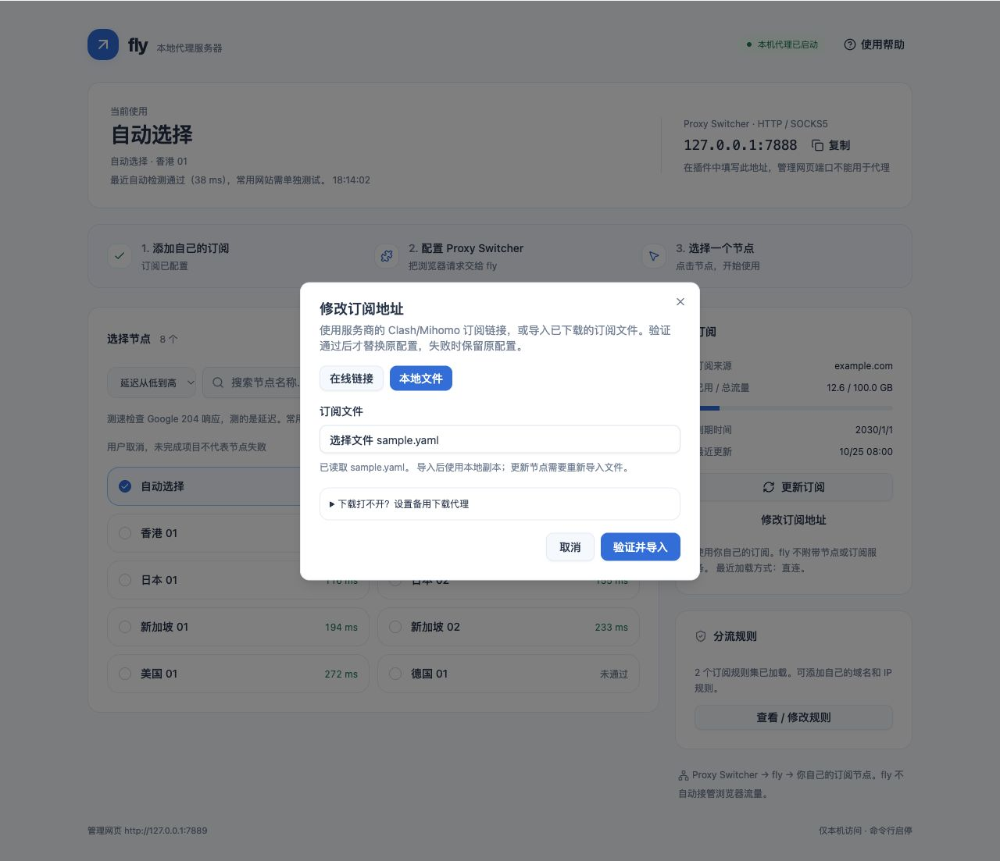
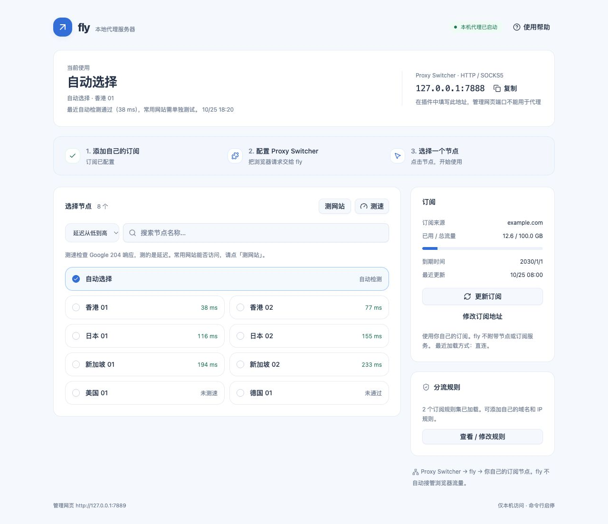
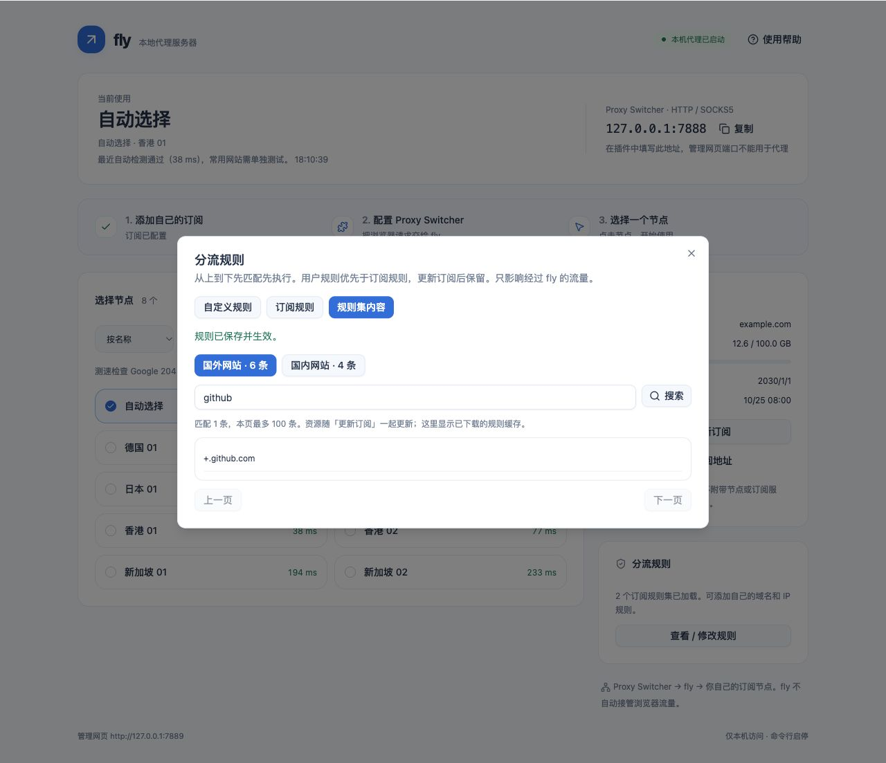

# fly 日常使用图文手册

fly 是本机服务器。命令行负责启动、停止；同一个蓝白网页负责订阅、节点和规则；**Chrome 的 Proxy Switcher and Manager 插件**把浏览器请求交给 fly。

第一次使用请按顺序看：[安装 fly](INSTALL.md) → [插件是什么、怎么安装和填写](PROXY_SWITCHER.md) → 本文。以下截图使用示例数据，节点、流量和网站结果不代表你的订阅。

## 1. 每天打开和关闭

打开终端，逐行复制并回车：

```sh
fly start
fly ui
```

- 第一条启动后台服务器；第二条打开网页，也会在终端打印实际网页地址。
- 默认管理页是 **[http://127.0.0.1:7889](http://127.0.0.1:7889)**，不是 7888。
- 重复 `fly start` 会提示已运行，不会再开一套。
- 关闭网页、关闭终端，服务器仍运行；重启电脑后需要重新启动。
- 不用时，先在插件点 **Direct**，再运行 `fly stop`。否则插件会继续连接已经停止的服务器。

## 2. 认识唯一的页面


| 位置 | 做什么 |
|---|---|
| 顶部状态「本机代理已启动」 | 表示本机代理端口已就绪，**不保证互联网或所有网站可用** |
| 「当前使用」 | 看所选节点、自动选择的实际节点、最近检测记录和时间 |
| 代理地址 | 默认 `127.0.0.1:7888`，复制给插件使用 |
| 「选择节点」 | 搜索、排序、换节点、测延迟、测网站 |
| 「订阅」 | 添加或更换来源、更新内容、查看服务商提供的流量信息 |
| 「分流规则」 | 查看 / 修改用户规则，搜索订阅规则和规则集内容 |
| 「使用帮助」 | 看三步提示，进入完整插件图文教程 |

**7888 填插件，7889 打开网页。** 两个端口属于同一个程序。没有第二套前端，不需要打开 9000、9090、3000。窄窗口里订阅和规则区域会排在节点列表下方。

## 3. 第一次添加在线订阅

1. 在「订阅」区域点「添加订阅」。
2. 去你自己的服务商页面，找到 **Clash / Mihomo 订阅链接**，点击复制。
3. 回到 fly，确认选的是「在线链接」。
4. 在「订阅地址」粘贴完整链接，包含问号后面的参数。不要填服务商首页、登录页、某个节点的名字或 PAC 地址。
5. 圆点表示链接被遮住了，内容没有丢失。眼睛图标可临时显示；显示完整链接时不要公开截图。
6. 点「保存并更新」，等待验证结束；不要重复点击。
7. 成功后弹窗关闭，节点出现，「本机代理已启动」。失败时弹窗和错误提示保留，旧地址与旧配置不会被新地址覆盖。
8. 点一个节点，或点「自动选择」。然后按[插件教程](PROXY_SWITCHER.md)启用 Manual Proxy。
9. 最后点「测网站」，确认本次节点能否连接常用网站。


链接、文件、协议和大小的完整要求见 **[订阅格式与下载故障说明](SUBSCRIPTIONS.md)**。有效订阅能解析出节点，不代表其中每个节点都在线。

### 订阅链接在本地打不开

先核对链接是否完整、套餐是否有效。401 / 404 通常应先核对账号或地址；超时、DNS 失败、连接失败则先检查网络。

如果你已经有一个能工作的下载代理：

1. 打开添加 / 修改订阅弹窗。
2. 点「下载打不开？设置备用下载代理」。
3. 在「备用下载代理」填完整地址，例如 `http://127.0.0.1:7890` 或 `socks5://127.0.0.1:1080`。
4. **这里是已在运行的服务的地址。示例端口不代表你的电脑一定有这个服务。** 没有就留空，不要把管理端口 7889 填进去。
5. 点「保存并更新」。fly 先尝试直连，失败后尝试备用下载代理，再尝试当前已有的 fly 节点。
6. 成功后，订阅区域会显示最近的加载方式。


fly 的下载不会偷偷借用 `HTTP_PROXY` / `HTTPS_PROXY` 等环境变量。首次启动还没有节点时，不能靠尚未建立的 fly 出口下载自己。没有可用下载出口时，用下面的文件方式。

### 导入已经下载的订阅文件

1. 在可以正常下载订阅的环境中，取得服务商导出的 Clash/Mihomo YAML 或节点链接文本文件。不要把登录网页另存为订阅文件。
2. 把文件放到这台电脑，例如「下载」文件夹。
3. fly 点「添加订阅」或「修改订阅地址」。
4. 点「本地文件」。
5. 点「订阅文件」旁的文件选择按钮，找到 `.yaml`、`.yml`、`.txt` 或 `.conf` 文件，选中并打开。
6. 看到「已读取 文件名」后，点「验证并导入」。文件最多 **8 MiB**，有效节点最多 **2000** 个。
7. 成功后，订阅来源显示「本地文件」。此后重启可使用保存的本地副本。
8. 服务商更新节点时，重新下载文件，再点「重新导入文件」。**本地文件不会每 24 小时自动变成服务商的最新版。**
9. 想改回在线链接，点「更换订阅来源」→「在线链接」，填链接并保存。



文件中的 HTTP 节点来源、外部规则集仍可能需要联网下载；真正离线导入应使用已展开的节点和内联规则。非法文件不会替换原配置。

## 4. 搜索、排序、切换节点

1. 在搜索框输入地区或名称，例如「日本」。搜索只筛选显示，不会自动切换节点。
2. 左侧下拉框可以选「订阅顺序」「按名称」「延迟从低到高」「可用在前」。
3. 自动选择在符合搜索条件时固定置顶。失败和未测不会被当成 `0 ms` 排在最快的位置。
4. 排序选择会在同一个浏览器、同一个管理页地址中保存；换浏览器或端口后可重新选择。
5. 点击节点卡片，等顶部「当前使用」和选中标记改变，再刷新目标网站。




切换主要影响之后的新连接。已经建立的视频、下载或长连接可能继续使用旧路径，需要刷新或重新连接。

### 自动选择和固定节点

- **自动选择**：定期检查节点，优先使用通过测试、延迟较低的节点；容差为 50 ms，避免很小的波动反复切换。
- **固定节点**：点击一个具体节点，适合希望保持某个地区的情况。检测失败不会擅自替你更换固定节点。
- 当前固定节点最近未通过延迟检测时，顶部会提示，并提供「尝试自动选择」按钮。
- 自动体检每 **300 秒**执行，目标为 Google 的 `generate_204`，每节点最多 **5 秒**，要求 HTTP **204**。这会产生后台检测请求；它也不是所有网站的可用性保证。

## 5. 测速：看延迟，不是下载速度

1. 在节点区域点「测速」。
2. 页面显示「已处理 X / Y」，尚未开始的节点显示「等待」。
3. 可以点「取消测速」。取消后会有明确提示，没测完不等于节点失败。
4. 结束后看数值和时间，再用排序下拉框选择「延迟从低到高」或「可用在前」。
5. 鼠标停在节点上可看检测来源与日期。顶部也显示当前节点最近记录的时间。

| 手动测速的参数 | 含义 |
|---|---|
| 目标 | `https://www.gstatic.com/generate_204` |
| 请求 | 一次 HEAD，请求到响应头的时间，包含建立连接和 TLS 握手 |
| 成功条件 | 返回 HTTP 204；收到其他状态不会当作通过 |
| 超时 / 并发 | 每节点 5 秒，最多 8 个同时执行，整批最多 90 秒 |
| 取消 / 整批超时 | 保留已完成结果，未完成项不编造成失败 |
| 订阅或规则改变 | 旧结果标为旧配置，不用它给新订阅排序 |

自动体检使用内核的重复请求计时，可能不包含第一次建立连接的耗时，因此与手动数值不同。测网站不会覆盖延迟结果。数值是某次观察，不能代替当前网站访问测试。

## 6. 单独检查常用网站

1. 选好你想使用的节点。
2. 点节点区域右上角「测网站」。
3. 保持「当前节点」，点「测试当前节点网站」。如果选的是自动选择，开始时会固定实际节点；弹窗显示其名字。
4. 等各个网站的结果出现。每个结果有状态、HTTP 状态码、耗时和日期时间。
5. 如需停止，点「取消测试」。关闭弹窗不会取消已经开始的测试。
6. 想核对分流规则，再选「浏览器分流」→「测试浏览器分流」。它经过本机代理端口，可能按规则直连，也可能使用当前节点。


| 结果 | 应怎么理解 |
|---|---|
| 响应正常 | 测试地址本次返回 2xx |
| 访问受限 · HTTP 401 / 403 / 429 | 已收到网站响应，但被认证、访问限制或频率限制拦住；不等于节点完全断网 |
| 网站返回错误 | 有响应，但地址或网站服务报错，需要在浏览器继续确认 |
| 连接失败 / 连接超时 | 本次没有成功取得响应，换节点、检查本机网络后重试 |
| 等待 / 未完成 | 还没有完成测试，不能推断节点坏了 |
| 旧配置提示 | 测试后更换了订阅或规则，需要重测 |

固定测试 Google、YouTube、GitHub、ChatGPT、Bing、百度的公开地址；每站最多 8 秒、最多 8 个并发。检查 GET 响应头，不登录账号、不下载视频，不保证网站所有功能、地区解锁或浏览器页面能完整加载。

排查时这样对照：

- 当前节点正常，浏览器分流异常：检查用户规则、订阅规则和拒绝项。
- 两种测试都正常，Chrome 异常：核对插件 Manual Proxy、HTTP / SSL 两行地址与端口，刷新新连接。
- 两种都失败：先试其他节点，再检查套餐、节点服务和本机网络；单个网站失败不要推断所有网站都失败。

## 7. 更新内容与更换来源

### 链接没有变，只更新节点和规则

1. 点「更新订阅」，或在终端执行 `fly update`。
2. 等更新结束，核对更新时间、节点和错误提示。
3. 再按需要测延迟 / 测网站。

在线订阅默认每 **24 小时**更新；其 HTTP 节点来源和规则资源随订阅一起更新，原订阅内单独设置的规则集更新间隔不另行启动后台任务。已有规则资源下载失败时可以保留该资源的缓存，但会明确提示；第一次必需资源就下载失败时，不会用一份缺失资源的新配置替换旧配置。

下载失败时，运行中的可用配置会保留；重启时只尝试**当前来源对应的缓存**，不会把上份订阅的节点冒充新订阅。缓存仍可能对应已下线的节点，不能保证永远可用。

### 换服务商或换了一条链接

1. 点「修改订阅地址」。本地来源则点「更换订阅来源」。
2. 等弹窗读完当前设置，再选「在线链接」。
3. 在地址框按 `Command + A`，粘贴新链接；需要时填写备用下载代理。
4. 点「保存并更新」。只有新内容验证、启用和保存成功，才算更换完成。
5. 失败时先读原因，原地址、用户规则和运行配置保留。不要因为点过按钮就认为已换成功。
6. 新来源没有原来的节点时，重新选择或使用自动选择。

插件只连接本机 fly。换订阅时不用去插件填写远端订阅链接。

流量、到期日来自服务商的响应信息；文件通常没有这些信息。「订阅未提供」不能当成流量为零或无限流量。

## 8. 查看和修改规则

浏览器先经插件进入 fly，fly 再按规则决定直连、拒绝或走所选节点。插件处于 Direct、插件绕过列表里的请求，或者浏览器直接绕过代理的本机请求，不会进入 fly 的规则。

### 添加一条例外

例如希望 `example.org` 及其子域名直连：

1. 在「分流规则」点「查看 / 修改规则」。
2. 保持「自定义规则」，点「添加规则」。
3. 左边选「域名及子域名」。
4. 中间填 `example.org`，不用填路径；也可粘贴完整 http(s) 网址，保存时会提取域名。
5. 右边选「直连」。
6. 点「保存规则」，看到「规则已保存并生效」。不点击保存，编辑不会生效。
7. 刷新目标网页，或用「浏览器分流」再测。


| 字段 | 怎么选 |
|---|---|
| 域名及子域名 | `example.org` 同时匹配 `www.example.org`、`api.example.org` |
| 仅此域名 | 只匹配这一完整域名 |
| IP 网段 | 例如 `192.168.1.0/24`；单个 IPv4 用 `/32`，IPv6 用相应前缀长度 |
| 代理 | 交给当前选择的节点 / 自动策略 |
| 直连 | 使用本机网络 |
| 拒绝 | 阻止连接 |

- 从上到下第一条匹配的用户规则优先；箭头可上移 / 下移，垃圾桶可删除，最后都要点「保存规则」。
- 用户规则最多 200 条，独立保存；更新和更换订阅后仍保留。重复或无效规则会报错，不会覆盖旧规则。
- 弹窗下面的「检查已保存的用户规则」可以输入域名、IP 或网址，查看命中第几条。它只解释已保存的用户规则，复杂订阅规则及 DNS 结果请用实际分流测试确认。
- 想撤回所有自定义规则，逐条删除后点「保存规则」；此后继续使用订阅 / 内置规则。

### 搜索订阅规则和规则集

1. 在同一弹窗点「订阅规则」，输入域名、规则类型或去向。
2. 这里列出当前实际顶层规则，包含优先执行的用户规则；较多时点「再显示 200 条」。
3. 看到 `RULE-SET` 时，切到「规则集内容」。
4. 点具体规则集名字，再输入关键词并点「搜索」。
5. 每页最多 100 条，可点上一页 / 下一页。支持常见 YAML、文本和 domain/ipcidr MRS 内容。
6. 数量为零或读取失败时查看错误、更新订阅；不能把没有有效条目的资源视为已完整生效。



没有规则的节点订阅会使用内置分流：局域网、国内域名 / IP 直连，其余走所选节点。订阅中的代理分组（包括 GLOBAL）统一映射到 fly 的当前节点，明确的 DIRECT / REJECT 保留。选国外节点不会自动把直连规则改成全局代理。

## 9. 常用命令

| 命令 | 用途 |
|---|---|
| `fly` / `fly start` | 后台启动 |
| `fly status` | 看本机进程、端口和节点加载情况；不等于互联网已测通 |
| `fly ui` | 打开唯一管理页 |
| `fly update` | 刷新在线订阅；本地文件请重新导入 |
| `fly restart` | 升级程序、改启动参数后重启 |
| `fly stop` | 先在插件切 Direct，再停止 |
| `fly version` | 看程序版本 |
| `fly init` | 看配置位置、端口、来源是否已设置；不打印完整订阅链接 |
| `fly run` | 前台调试，Ctrl+C 退出；不要同时启动后台实例 |

初学者用网页改订阅。高级用法 `fly init --url ...` 也会验证后更换；直接把链接写进命令会留在终端历史，不适合公开演示。

### 只有端口冲突时，才需要修改代理端口

先把插件切 **Direct**，再按顺序执行。例如改为代理 17888、管理 17889：

```sh
fly stop
fly init --port 17888 --admin 127.0.0.1:17889
fly start
fly status
fly ui
```

1. 如果第一条提示未运行，继续下一条。
2. 插件 HTTP / SSL / FTP 行的 Port 同步改成 **17888**，主机仍是 `127.0.0.1`，Server Type 仍是 HTTP，点绿色 ✓。
3. 管理页改为 **http://127.0.0.1:17889**；不要再打开 7889。
4. 运行中不能直接修改监听端口，先停再改。两个端口必须不同、在 1–65535 之间，管理地址必须是本机回环 IP。
5. 想恢复默认，用同样顺序将 `--port` 改为 `7888`，`--admin` 改为 `127.0.0.1:7889`，同时恢复插件端口。

## 10. 突然不能用时

1. 插件先点 **Direct**，恢复浏览器直连路径。
2. 运行 `fly status`；未运行就 `fly start`。
3. 打开管理页，看是订阅错误、本机端口未就绪，还是节点最近未通过。
4. 本机已启动：先换节点或点「尝试自动选择」，再测网站。
5. 节点测试通过但浏览器仍失败：核对插件并新开网页；若分流测试失败，检查规则。
6. 订阅下载失败：检查链接、套餐、备用下载代理，必要时导入本地文件。
7. 仍有问题，按[常见问题](FAQ.md)对应现象排查。

[返回首页](../README.md) · [订阅格式与限制](SUBSCRIPTIONS.md) · [插件超详细教程](PROXY_SWITCHER.md)
