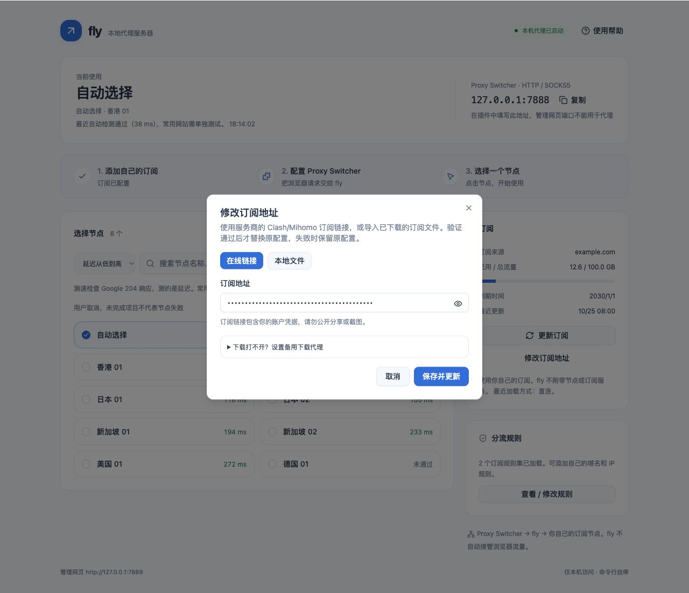
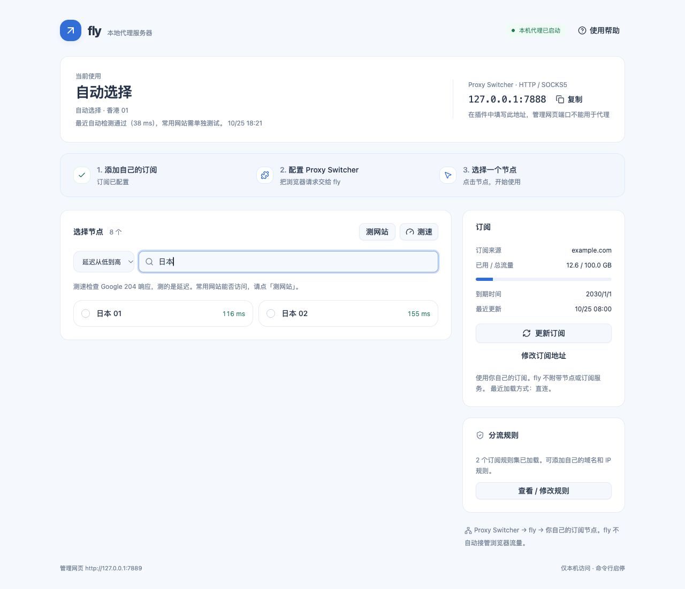
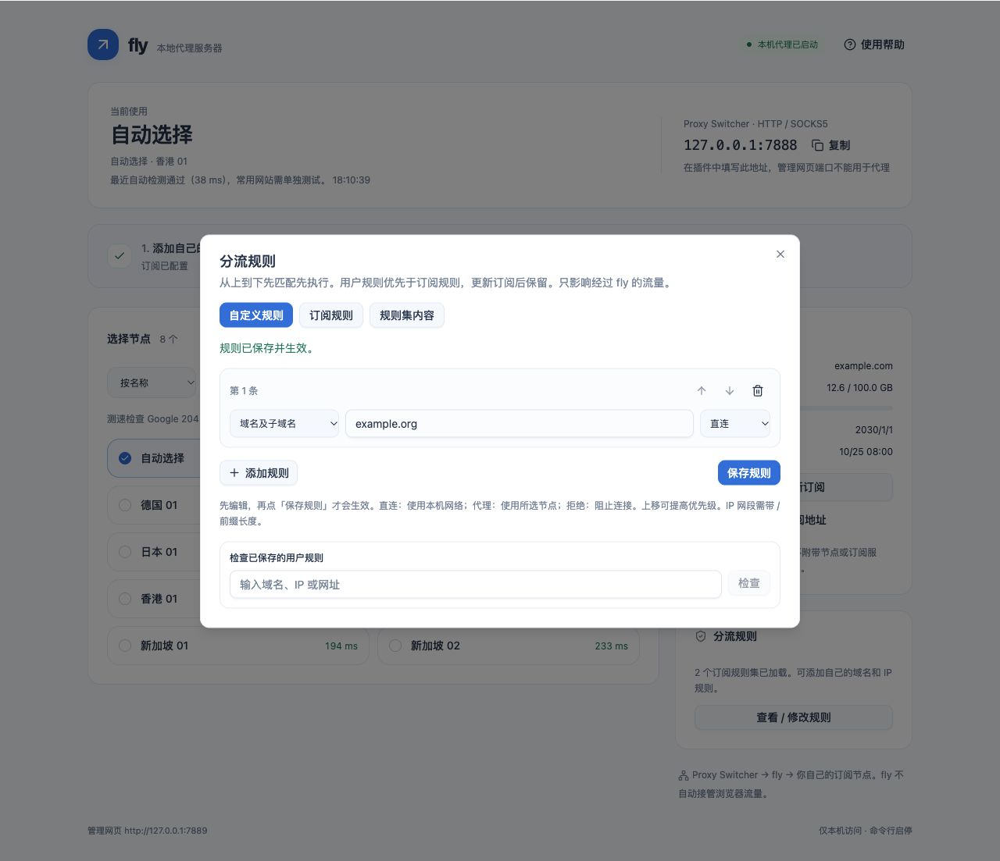

# fly 日常使用图文手册

fly 用命令行启停，用一个网页选节点、测速和管理订阅。浏览器通过 **Proxy Switcher and Manager** 使用它。

第一次接触请按顺序阅读：[安装 fly](INSTALL.md) → [安装和配置插件，每一步都有说明](PROXY_SWITCHER.md) → 本文日常操作。插件不会自动安装，也不会自动配置。

## 打开、启动和停止

打开终端，复制命令并按回车：

```sh
fly start
fly ui
```

第一条启动服务器，第二条打开管理页。默认地址是 **[http://127.0.0.1:7889](http://127.0.0.1:7889)**。`fly ui` 不会代替 `fly start`。

- 已经运行时，再执行 `fly start` 只会提示已运行。
- 关闭网页不影响代理；关闭终端也不影响后台服务器。
- 重启电脑后需要重新 `fly start`。
- 停止之前先点插件 **Direct**，再运行 `fly stop`，避免浏览器仍然连接一个已停止的服务器。

## 认识唯一的管理页面


从上到下看：

| 页面位置 | 能做什么 |
|---|---|
| 顶部「当前使用」 | 查看所选节点；选择自动时也能看实际使用的节点 |
| 顶部右侧「代理地址」 | 复制给插件使用的地址；默认 `127.0.0.1:7888` |
| 中间「选择节点」 | 搜索、测速、点击切换节点或自动选择 |
| 右侧「订阅」 | 看流量、到期日期、更新时间，更新内容、修改链接 |
| 底部「查看规则详情」 | 展开查看分流项、规则集和实际加载数量 |
| 右上角「使用帮助」 | 查看填写参数，跳转完整插件教程 |

**7888 给插件；7889 用来看网页。** 它们是同一个 fly 程序的两个用途。没有第二套前端，也不需要去打开 9000、9090 或开发用的 3000。

## 第一次添加订阅

1. 在右侧点击「添加订阅」。
2. 从自己的订阅服务商处复制完整订阅链接。
3. 粘贴到弹窗的「订阅地址」中。
4. 输入框默认显示圆点，点击眼睛图标可以临时显示；不要在显示完整链接时截图分享。
5. 点击「保存并更新」。
6. 等待节点出现，顶部显示「服务运行中」。
7. 点击一个节点或「自动选择」。
8. 按[插件教程](PROXY_SWITCHER.md)配置 Chrome；只在 fly 中选节点，不会自动让浏览器走代理。



链接必须以 `http://` 或 `https://` 开头。项目支持 Clash YAML，以及包含支持的节点链接的订阅；并非所有服务商格式、协议、加密参数都一定兼容。错误链接或无有效节点时，页面会提示问题。

## 切换节点

1. 在「选择节点」区域找一个节点。
2. 节点较多时，在搜索框输入地区或节点名，例如「日本」。
3. 点击该节点，等待请求完成。
4. 被选中的卡片出现选中样式，顶部「当前使用」改为这个节点名。
5. 切回目标网站，刷新网页或新开一个标签页。



节点切换主要影响后续新连接。已有的下载、视频或长连接不一定立即迁移；需要时刷新或重新连接。切换失败时，会保留错误提示，请检查服务状态后重试，不要根据点击动作就判断已成功。

### 自动选择怎么用

点击「自动选择」，fly 会使用自动策略中的节点；顶部显示自动策略当前实际选择的节点。需要固定地区时，直接点击那个地区的具体节点即可。

### 测速怎么看

1. 点击节点区域右上角「测速」。
2. 等待测速完成，期间按钮暂时不可操作。
3. 节点旁边会显示毫秒数，例如 `120 ms`。数值较小表示测试网址响应较快。
4. 失败、超时或尚未测得数值时，检查提示，或换一个节点再试。

测速不等于带宽测速，也不保证所有目标网站都能访问；一次失败可能是节点、网络或测试网址的问题。

## 更新订阅内容

服务商更新了节点、流量信息或规则，而**链接没有变化**时：

1. 在右侧点击「更新订阅」。
2. 等待刷新结束，不要反复点击。
3. 核对更新时间、节点列表和是否出现错误提示。
4. 需要时展开规则，检查规则集是否就绪。

也可在终端执行：

```sh
fly update
```

默认还会每 24 小时刷新一次。更新失败时会尽量保留之前可用的配置；提示使用缓存，表示本次联网更新没有成功，**不是已经拿到最新订阅**。修复网络或订阅问题后再点更新。

## 更换订阅链接

服务商给了新链接，或你想换一份订阅时：

1. 在右侧点击「修改订阅地址」。
2. 等弹窗读取当前地址。读取失败时关闭后重试，不要覆盖未知配置。
3. 点击「订阅地址」输入框，按 `Command + A` 全选。
4. 粘贴新的完整链接。
5. 点击「保存并更新」。
6. 等待结果，确认新节点出现和服务就绪。
7. 如果旧节点不在新订阅中，重新选择一个可用节点。

不需要去插件里改订阅。插件仍然连接本机 `127.0.0.1:7888`，远端节点由 fly 管理。

### 流量和到期日期为什么是空的

这些信息来自订阅服务商提供的响应信息。如果服务商没提供，页面会显示未提供或占位，不能凭空计算套餐余额。节点是否可用要结合服务状态和实际访问判断。

## 理解规则：为什么有些网站仍然直连

先点页面下方「查看规则详情」：



- **分流项**：决定什么请求走哪条策略。
- **DIRECT**：直连；**REJECT**：拒绝；需要代理的策略使用你当前所选的节点或自动策略。
- **规则集**：服务商把许多域名 / IP 规则放在一起，fly 展示其实际加载数量。
- **尚未就绪 / 数量为零**：该资源可能没下载成功或没有有效规则，不能认为已经完整生效。

浏览器请求的顺序是：**插件先把请求交给 fly → fly 再按规则决定直连、拒绝或走所选节点**。

这个插件的 Manual Proxy 配置主要负责把浏览器请求交给 fly；表单中的 Direct 地址列表列出的地址，以及 Chrome 本身绕过代理的本机地址，不会经过 fly。没有发给 fly 的请求，也不会经过 fly 的规则。

订阅中的直连、拒绝和子规则结构尽量保留；需要代理的策略统一使用当前节点。没有提供分流规则的普通节点订阅会使用内置分流，局域网和国内地址直连，其余交给节点。更换节点不会让所有网站自动变为“全部代理”。

## 常用命令放在这里

| 命令 | 什么时候用 | 成功时看什么 |
|---|---|---|
| `fly start` 或 `fly` | 启动后台服务器 | 已启动 / 已在运行 |
| `fly status` | 不确定服务器是否可用 | 运行状态、代理就绪情况、节点数量 |
| `fly ui` | 打开唯一管理页 | 浏览器显示 fly |
| `fly update` | 手动更新同一订阅 | 刷新完成，或明确失败提示 |
| `fly restart` | 升级程序、修改启动参数后 | 重新启动，再用 status 核对 |
| `fly stop` | 停止后台服务器 | 先把插件切 Direct，再看已停止 |
| `fly version` | 查看版本 | fly 和版本号 |
| `fly run` | 需要前台排查时 | 输出日志，按 Ctrl+C 结束；不要和后台实例重复启动 |

`fly init` 会显示配置（包括完整订阅链接），不要截图公开分享。初学者修改订阅请直接用网页。

### 只有端口冲突时，才需要修改代理端口

先在插件中切 Direct，再执行下面的示例。它把代理端口改成 7887；这不是默认推荐配置：

```sh
fly init --port 7887
fly restart
fly status
```

然后把插件 HTTP / SSL / FTP 行的 Port 改成 **7887**，点绿色 ✓ 保存。管理页仍是 7889。想改回默认值，用 `fly init --port 7888`，重启后同步修改插件。

管理地址由 `~/.fly/fly.yaml` 中的 `admin-addr` 决定，初学者通常不需要改。已经改过时用 `fly status` 查看实际地址，不能继续盲用默认端口。

## 出问题时的最短恢复办法

1. 插件点 **Direct**，先让 Chrome 不再依赖 fly。
2. 终端运行 `fly status`。
3. 未运行：`fly start`。未就绪：`fly ui` 检查订阅和错误提示。
4. 节点就绪：检查插件地址、HTTP / SSL 两行端口和 HTTP 类型，再切回 Manual Proxy。
5. 仍失败：换节点，检查订阅有效期，按[常见问题](FAQ.md)继续排查。

[返回首页](../README.md) · [插件超详细教程](PROXY_SWITCHER.md) · [安装、升级和卸载](INSTALL.md)
